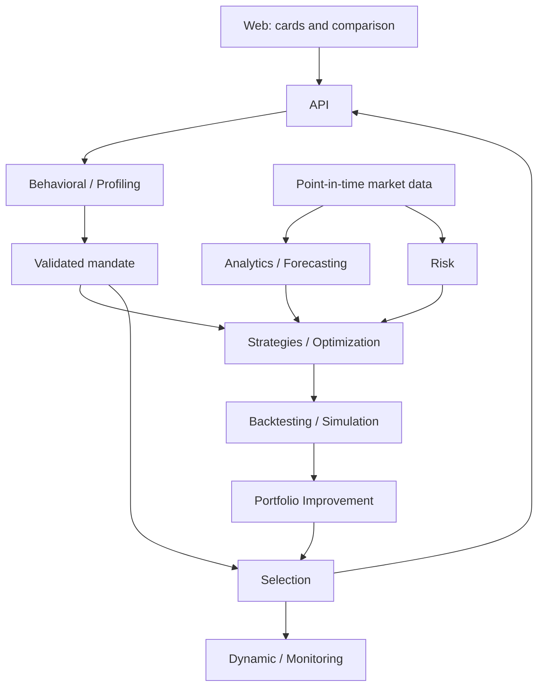

# Technical Architecture

Target frontend: React/TypeScript; API: Python/FastAPI; quantitative engine independent of UI; market data Parquet/DuckDB; production profiles/sessions PostgreSQL. Begin with modular monolith, add async workers only if needed. Select dependencies and versions as a team.

Contracts: MarketSnapshot(as_of, universe_version, dataset_hash), Forecast(mu, covariance, horizon, model_version), Candidate(weights, futures_positions, collateral, constraints, provenance), Evaluation(metrics, costs, stress, period, warnings), Selection(candidate_id, mandate_version, consent, timestamp). Every amount carries currency, every return frequency, every derivative its multiplier. See the A–Z guide for ten engines.

SYS.01: GoalSpec and ConstraintSet (mandate), ForecastBundle (mean/distribution), RiskReport (covariance, losses, stress), StrategySpec (signal/execution), OptimizerSpec (numerical objective/constraints), Candidate (positions/provenance). Improvement compares candidates via ablation on identical reference frames before selection. Explore swipes never make a rejected candidate eligible. [TASK_DEPENDENCIES.csv](TASK_DEPENDENCIES.csv) defines ticket prerequisites.

The base Python contracts live in `src/riskmatch/contracts.py` (schema 1.0.0). All new contract artifacts carry `RunMetadata`; UTC as-of, run ID, schema and model versions, explicit units, warnings, status and provenance are required. `ClientProfile` defines a pseudonymous envelope; detailed financial fields and objective validation belong to chapters 01 and 12, not the infrastructure gate. Forecasts and risk are separate, with aligned instrument IDs and periods. Funded weights and futures contracts are separate; selection is paper-only. Existing demo endpoints retain their experimental legacy shapes until the API migration in CH27.07–08.

`src/riskmatch/eligibility.py` defines conservative initial requirements for all 64 construction, strategy, factor and dynamic methods (11 client objectives are a separate catalog). Method validation is explicit and defaults to unavailable; data, frequency, instrument, Treasury verification, capacity, shorting, leverage and derivatives/margin checks produce diagnostic reasons. No registry entry alone constitutes an approved financial model. Requirements will be refined with each model's validation.

| Directory | Responsibility |
|---|---|
| apps/web | card UI, profile, comparison, EN/FR localization |
| apps/api | auth, endpoints, orchestration |
| src/riskmatch/behavioral | item bank, sessions, scoring |
| profiling | mandate and feasibility |
| market_data | ingestion, calendars, corporate actions |
| analytics / forecasting | statistics, signals, forecasts |
| risk | covariance, ES, factors, stress |
| optimization / strategies | construction and management rules |
| backtesting / simulation | P&L, costs, walk-forward and Monte Carlo |
| selection / dynamic | matching and dynamic policies |
| configs | versioned non-secret parameters |
| tests | synthetic data, invariants, integration |
| data | local data excluded from Git |

Initial architecture only: avoid premature microservices, independently test interfaces and reproducible seeded, data-hashed runs.

Treasury-only eligibility is a hard upstream constraint. Verify issuer and historical bond ETF holdings; raw out-of-scope data are retained but cannot produce eligible positions. See UNIV.01 and guide chapter 2.

The local V3 demonstration uses fixed synthetic data. The Web App is bilingual; canonical API values and development artifacts are English. Local simulation saves are encrypted in browser storage; they do not constitute accounts or server-side persistence.
