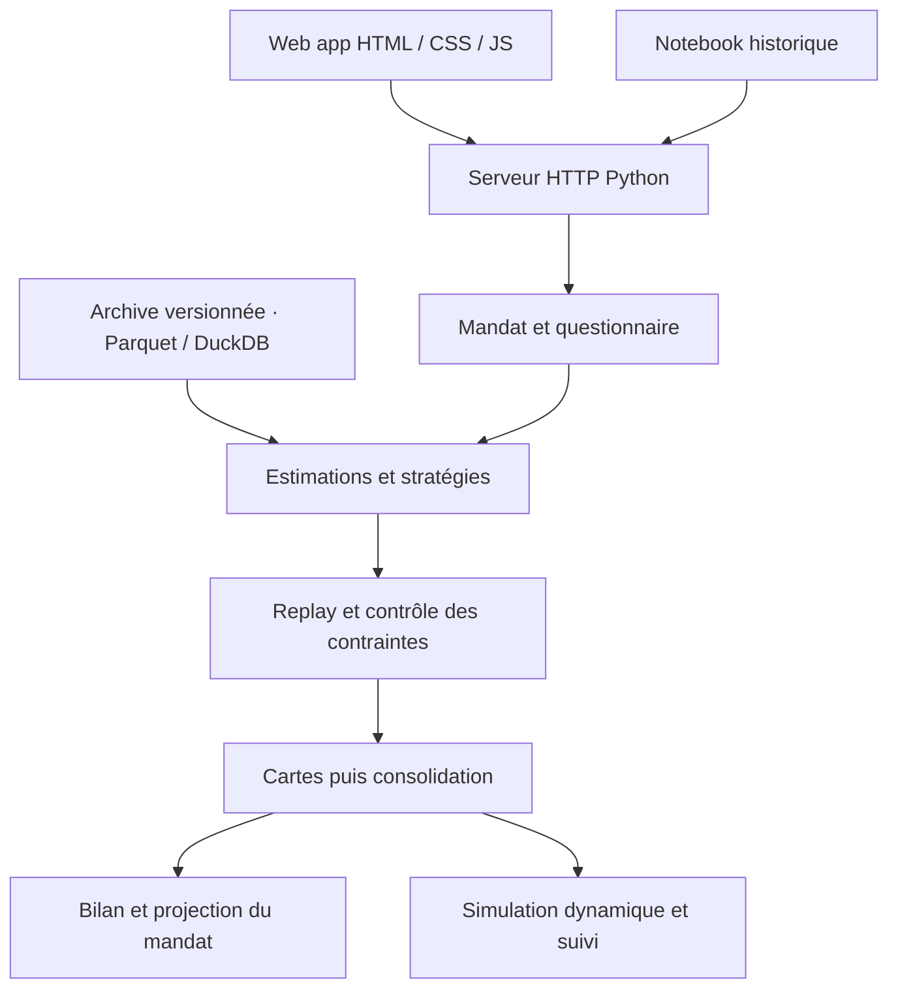

# Architecture de RiskMatch V3

La version présentée utilise une interface HTML, CSS et JavaScript bilingue, un serveur HTTP Python sur la boucle locale et un moteur quantitatif partagé. Le notebook appelle les mêmes handlers pour ses vérifications historiques. Les données de recherche sont chargées à partir des fichiers locaux versionnés, notamment Parquet via DuckDB.

| Emplacement | Rôle dans le parcours actuel |
|---|---|
| `apps/web` | Mandat, cartes Discovery, recherche, comparaison et bilan Mes matchs. |
| `apps/api/server.py` | Routes JSON, validation des appels et distribution des fichiers web. |
| `src/riskmatch/profiling`, `behavioral` | Vérification du mandat, capacité de perte et questionnaire. |
| `src/riskmatch/market_data`, `analytics` | Sources datées, rendements, covariance et scénarios d’objectifs. |
| `src/riskmatch/optimization`, `strategies`, `backtesting` | Cibles, optimisations, replays et coûts simulés. |
| `src/riskmatch/personalized_matches.py`, `selection`, `dynamic` | Éligibilité, classement, poids consolidés, projection et règles de gestion. |
| `apps/streamlit` | Cadre pour l’interface complète, utilisé sur le même hôte ou derrière un accès protégé. |
| `apps/course_demo` | Démonstration Streamlit synthétique autonome pour GitHub Pages. |
| `notebooks`, `tests` | Notebook portable, preuves calculées sur l’archive dans la copie locale et tests de régression. |

Les sauvegardes du parcours sont conservées dans le navigateur. Le serveur de simulation ne possède pas de base de comptes multiutilisateur. Pour un accès distant, le proxy doit garder l’interface et l’API sous la même protection et les archives sur l’hôte autorisé. Le [guide Streamlit](../apps/streamlit/README.md) décrit le montage. La feuille de route conserve les études et extensions d’infrastructure au-delà du périmètre présenté. [Parcours](CLIENT_FLOW.md) · [Audit](AUDIT_STRATEGIES_ET_PORTEFEUILLE.md) · [Feuille de route](ROADMAP.md)
