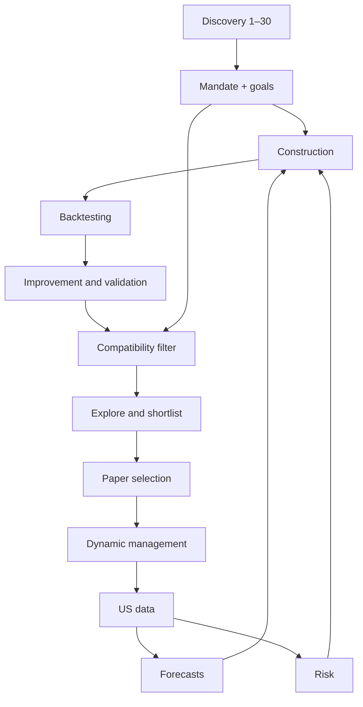

# Collaborative Roadmap — RiskMatch Execution Order

The [single notebook](../notebooks/RiskMatch_V3.ipynb) is the research lab. The [checklist](../CHECKLIST_A_Z.md) is the detailed backlog and the [dependency registry](TASK_DEPENDENCIES.csv) defines prerequisites. All 75 catalog slots remain; Treasury Curve replaces Credit under the Treasury-only universe.

| Gate | Work and chapters | Deliverable / exit condition |
|---|---|---|
| G00 | Infrastructure, contracts, CI (27, INFRA, SYS) | reproducible environment, separate schemas, Git |
| G01 | Mandate + 11 objectives + Discovery (01, 02, 12) | typed objectives, exploratory score, incompatible constraints identified |
| G02 | US ETF/cash data (03–06) | dated data, licenses, total return, FX, leakage tests and Treasury-only filter UNIV.01 |
| G03 | Baseline analytics, forecasts and risk (07–09, 11, 13–14) | PSD covariance, historical mean, 1/N and 60/40, tested optimization |
| G04 | Reference backtest (BT00) | ETF ledger, fees, OOS, simple stress, metrics and comparison |
| G05 | **RiskMatch MVP** | mandate → Discovery → compatible allocations → swipe → paper choice |
| G06 | Eligible ETF optimizers and strategies (15–20, OPT/STR) | common benchmark; no model without corresponding data |
| G07 | Expanded universe (03–06, 10, 21–23) | PIT fundamentals, individual Treasuries, futures, roll/margin/coupons, extended ledger |
| G08 | Financial catalog excluding dynamics; improvement + final matching (08–25, IMP/MATCH) | ablations, eligible candidates, explainable shortlist |
| G09 | Dynamics, integration and review (26–27, DYN) | monitoring, rebalancing, paper trading, independent validation |

Independent preparation can proceed in parallel. Gates control delivery, not all research: synthetic fixtures can precede real data, but not OOS validation on those data.

## Decision Architecture

Objective = decision function; data = available observations; forecasting = estimated distribution/mean; risk = covariance, losses and limits; strategy = signal and execution rules; optimizer = weights; backtest = evaluation; improvement = incremental evidence; matching = selection among approved candidates. Black-Litterman is a composable estimator, not a standalone strategy.

The RiskMatch experience remains central: accessible cards, no forced answers, exploratory score independent of financial capacity, comparable compatible portfolios, like/dislike/skip/undo, comparison and simulated choice. Psychometric validation starts at G01 and continues through G09. No real orders.

## Execution Workflow

- `python scripts/task_dependencies.py --ready`: tickets with all prerequisites checked.
- `python scripts/task_dependencies.py --task OPT07.06`: ticket and prerequisites.
- `python scripts/task_dependencies.py --check`: coverage, acyclic graph and current registry.
- `python scripts/task_dependencies.py --build`: regenerate the registry after authorized ticket changes.

IDs are stable. Validate a ticket with notebook evidence, tests, shared engine, UI where applicable and PR. Generic chapter checkboxes are closure checks, not additional tickets.

## Suggested Team Roles

- Quant research: estimation, optimization, strategies and mathematical documentation.
- Data and backtesting: data, licenses, P&L, quality and reproducibility.
- Behavioral research: questionnaire, protocol, calibration and validation.
- Product and engineering: swipe UX, API, integration, security and CI.

First sprint: unblock SYS.01–02, specify ClientProfile, 11 GoalSpecs and Card while setting up GitHub. Create synthetic fixtures and exploratory score. G01 requires G00; baselines and minimal backtest follow G02. One issue per ID and a tested PR per deliverable.
