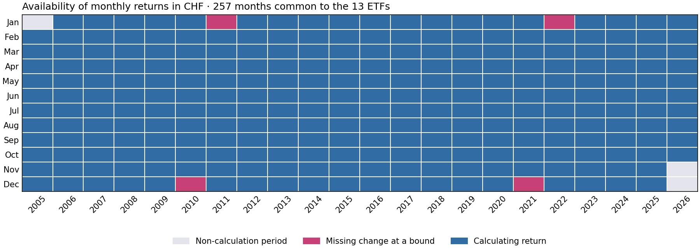

# 1.3 · First market history in CHF

The 13 ETFs each have **257 monthly exploitable returns** between February 2005 and October 2026. The 3,341 lines of the local catalogue cover ten equity funds (SPY and nine sectors), two US Treasury funds (IEF and TLT) and one gold-exposed fund (GLD).



**Reading the calendar.** Each box represents one month. Out of 261 candidate months, December 2010, January 2011, December 2021 and January 2022 are excluded. The last session of December 2010 and the December 2021 session were not observed on the same day. In each case, the end-of-month level required for the two adjacent returns is missing. January 2005 provides the first starting level. November 2026 is still incomplete in extraction. A continuous performance path on these interruptions would require a documented agreement in step 1.4.

## Data and calculation

| Local entrance | Unit | Observations and coverage |
|---|---|---|
| Yahoo Finance, 13 daily extractions with adjusted prices | USD per share | 5,505 sessions per instrument from 3 January 2005 to 18 November 2026 |
| Federal Reserve H.10 via FRED, DEXSZUS | CHF for 1 USD | 14,009 prices on 14,575 lines dated 4 January 1971 to 13 November 2026 |

For each ETF, the value in CHF at the end of the month is the price adjusted in USD multiplied by the exchange on the same day. Performance is the ratio between two consecutive month end values, minus one. The calculation uses the last observed session of the file and discards its last month. Adjusted price serves to approximate return with distributions. Personal taxation, transaction costs and exchange charges still need to be modelled.

The 14 files were collected by their local sources on 21 November 2026 and imported into V2 on 23 November. Their collection date attests to the availability of this version. The time of first publication of each observation and the old versions of the adjustment remain unknown. This catalogue is used for the historical description. A decision-making round and eligibility for negotiation require the controls of steps 4.4 and 4.8. Individual data and their returns remain locally.

The manifest contains the original query parameters, version, SHA-256 fingerprints, supplier, unit, time of collection and dissemination rule. The coverage statement gives the extreme dates, numbers and checksum of the result. [Entry manifest](../../config/import-2026-11-23.json) · [Cover statement](coverage.json)

## Reproducing

In V2, place the 14 named files in the manifest in `data/local/1.3/raw/`. Once the package is installed, run the following commands from the V2 root.

```sh
python -m riskmatch_v2.market_import
jupyter execute RiskMatch_V2.ipynb
```

The import checks the checksums before calculation and writes the private catalogue in `data/local/1.3/2026-11-23.1/returns.csv`. Relaunching the same import checks the identity of the exits. A modified file suspends import. To accept a revision, keep old files, review the change of scheme or price, create a manifest with a new ID and restart with `--lock` and `--raw`. The notebook can also trace the coverage from the statement published on an autonomous copy of the deposit.

A reconciliation with the other local export of adjusted prices, `etf_prices_adjusted.csv`, gives a maximum absolute difference of 0.027 basis point out of the 3,341 returns in CHF. Both exports are close but their adjusted values differ slightly. The catalogue contains files whose requests and collection times are documented.

## Sources to qualify for the next steps

| Need | Available or to be examined | Status and consequence |
|---|---|---|
| Individual stocks, fundamentals, write-offs | Local extracts CRSP, Compustat and CCM | To be qualified in stages 4 and 9. The individual stock prices of 2026 remain to be completed for a date proposal. |
| Executable prices, purchase-sales gap, fees, lots and account access | Listing files and broker's scale | To be verified before any allocation announced as negotiable. |
| Direct bonds | Local data to be inventoried, Treasury Fiscal Data and FINRA transactions to be examined | Prices, coupons, deadlines and batches to be connected. IEF and TLT already provide history of bond funds. |
| Environmental exposures, overlaps and exclusions | Dated positions of funds and declarations SEC N-PORT | Coverage by weight and by transmitter to be established. |
| Scenarios and forecasts | Local archive macro FRED/ALFRED, VIX, energy and feeling of the prices | Check hours, revisions, rights and coverage before time tests. |
| Cash in CHF | Account rate in CHF or explicit date assumption | To be defined if the reference includes a investment sleeve of paid cash. |

**Transversal control of sections 1 to 6.** As of October 30, 2026, the multi-asset study submitted 3,322 securities, including 3,255 individual stocks, 54 direct Treasuries and 13 ETFs. Previous comparisons of 13 ETFs are used as a control. [Multi-asset report](../univers-complet/README.md) · [Evidence by box](../univers-complet/AUDIT.md)
