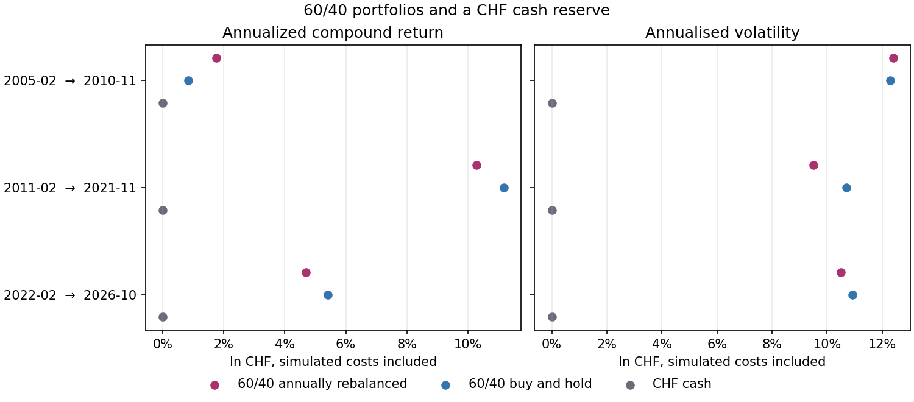

# 1.4 · What does the rebalancing of a 60/40 in CHF change?

Over the most recent period, from February 2022 to October 2026, **100 CHF become 124.32 CHF** by returning annually to 60% of US shares (SPY) and 40% of US Treasury bonds (IEF). With the same initial purchases, keep shares gives **128.41 CHF**, with an annualized historical volatility a little higher.

## Three independent periods

Each line starts from CHF 100 before the original purchase. Dates are first and last **month of return**. The exchange rate is missing for two years in the catalogue, which prevents the chaining of the three periods. The final capital corresponds to a valuation of the positions in CHF. For a future personalized comparison, take the intersection of the dates of all candidates and replay each strategy with the same capital, continuous periods and costs.

| Period | Month | Management of 60/40 | Net monthly average | Total compound gain | Annualized compound | Annualised volatility | Fees paid in CHF per 100 initial CHF |
|---|---:|---|---:|---:|---:|---:|---:|
| Feb. 2005 – Nov. 2010 | 70 | Annual | 0.21% | 10.70% | 1.76% | 12.40% | 0.1564 |
| | 70 | Conservation | 0.13% | 4.93% | 0.83% | 12.29% | 0.0999 |
| Feb. 2011 – Nov. 2021 | 130 | Annual | 0.86% | 188.95% | 10.29% | 9.51% | 0.1976 |
| | 130 | Conservation | 0.93% | 215.33% | 11.18% | 10.70% | 0.0999 |
| Feb. 2022 – Oct. 2026 | 57 | Annual | 0.43% | 24.32% | 4.69% | 10.51% | 0.1252 |
| | 57 | Conservation | 0.49% | 28.41% | 5.41% | 10.91% | 0.0999 |

The monthly average gives the return of an average month. The total compound gain follows the actual simulated capital. The annualized compound is the constant rate that would give the same final capital in as many months. Volatility is the sample standard deviation of net monthly returns multiplied by Â12. The third benchmark retains CHF 100 nominal cash without remuneration and without charge over each period.

## Schedule, fees and accounting control

- Both funds are purchased at the starting point. In conservation, weights change with prices. In annual management, the weights are restored before the January return, on the valuation at the end of December. The simulation uses fractional shares and a predetermined monthly schedule. The next session will be held in 6.3.
- The central scenario **10 base points (0.10%) on each amount purchased or sold**, including initial purchase. The costs are funded in the investment sleeve. The model adjusts the orders to find the target weights after their payment. The costs shall combine the amounts actually debited. No final liquidation order, personal taxation, foreign exchange spread or additional custody is simulated. The exchange values the positions at the observed price. The rate of 10 bp is a working hypothesis.
- À **0, 10 and 25 pb**, over the last period, the annualised compound of annual management is valid respectively **4.72%, 4.69% and 4.65%**. In conservation it is worth **5.43%, 5.41% and 5.37%**. The results file gives the three periods.
- For each month, initial capital of the month minus fresh plus gain or loss of positions equal to final capital. The 771 flow lines (257 months × 3 references) are kept in the local registry. The tests check on a case calculated by hand the drift of weights, both sides of rebalancing and the identity between compound returns and capital.

## Compatibility with mandate

| Theoretical mandate and confirmed criteria | 60/40 annually rebalanced | 60/40 buy and hold | CHF cash |
|---|---|---|---|
| Free investment sleeve authorizing both funds and CHF | Compatible with tested criteria | Compatible with tested criteria | Compatible with tested criteria |
| Reserve in CHF only | outside mandate | outside mandate | Compatible with tested criteria |
| Same assets permitted, historical volatility ceiling of 5% | outside mandate for the three periods | outside mandate for the three periods | Compatible with tested criteria |
| Profile to be confirmed | Undetermined | Undetermined | Undetermined |

Control accepts an authorized universe and boundaries of historical volatility. It retains the grounds for refusal and indicates any additional requirements to be investigated. For a real applicant, the expected risk, deadlines, possible indirect exclusions and access to the account will have to be verified by yards 2 to 6. Strategies outside the mandate remain visible as points of comparison.

## Reproducing and Retrieving Data

Aggregate return sources: monthly adjusted rates of SPY and IEF from Yahoo Finance, valued at the DEXSZUS exchange rate of the Federal Reserve via FRED. The local vintage is the one validated in 1.3. The parameters and checksum of the catalogue are kept with the results. [Manifest and cover](../01-3-import-marche/README.md) · [Parameters](../../config/references-1.4.json) · [Results by period, sensitivity and reasons by mandate](resultats.json)

Since V2, launch `python -m riskmatch_v2.benchmark` after import 1.3. The detailed monthly register is available in `data/local/1.4/registre.json`. The notebook allows the graph to be retrieved from the shared aggregates and, in the presence of local data, to recalculate the study. [Notebook](../../RiskMatch_V2.ipynb) · [Engine tests](../../tests/test_reference.py)

**Transversal control of sections 1 to 6.** As of October 30, 2026, the multi-asset study submitted 3,322 securities, including 3,255 individual stocks, 54 direct Treasuries and 13 ETFs. Previous comparisons of 13 ETFs are used as a control. [Multi-asset report](../univers-complet/README.md) · [Evidence by box](../univers-complet/AUDIT.md)
