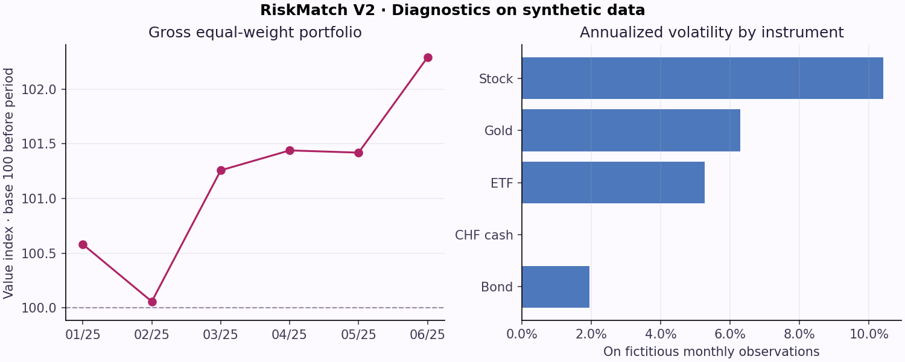

# 01 · Diagnosis of the fictitious catalogue

Monthly returns from January to June 2025 are fictitious and expressed in CHF. The curve shows the portfolio of instruments equal-weight each month, before fees, base 100 before the first month. Bars show the monthly standard deviation annualized by the square root of 12. The petroleum factor remains in the catalogue and does not participate in the composition of the portfolio.

**Reproduction.** Run Section 1 of the [Notebook](../../RiskMatch_V2.ipynb) from the V2 folder after option installation `notebook`. The calculations use the [fictitious catalogue versioned](../../src/riskmatch_v2/demo/returns.csv).
