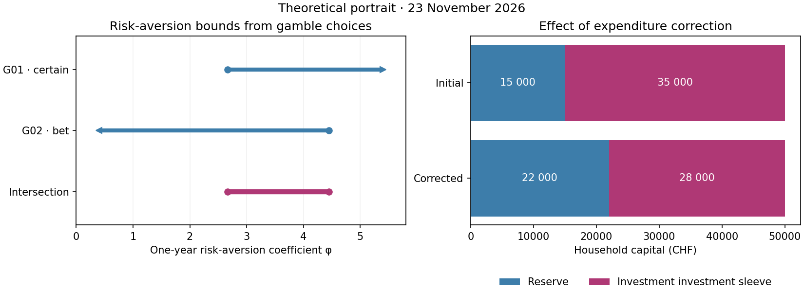
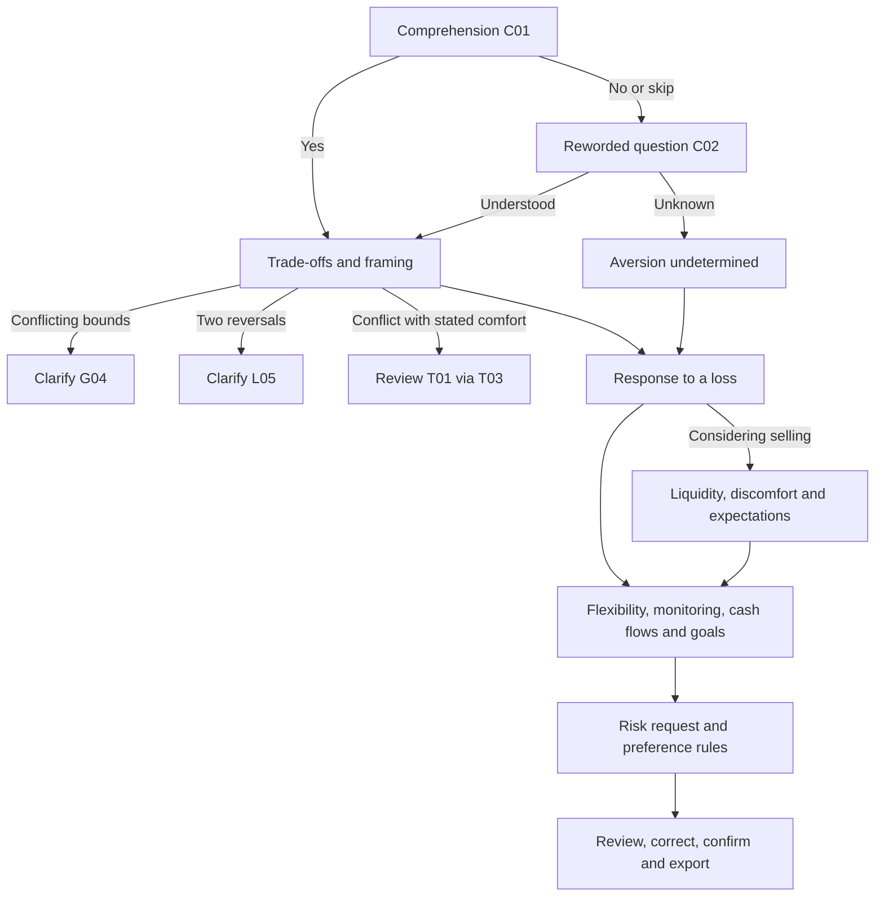
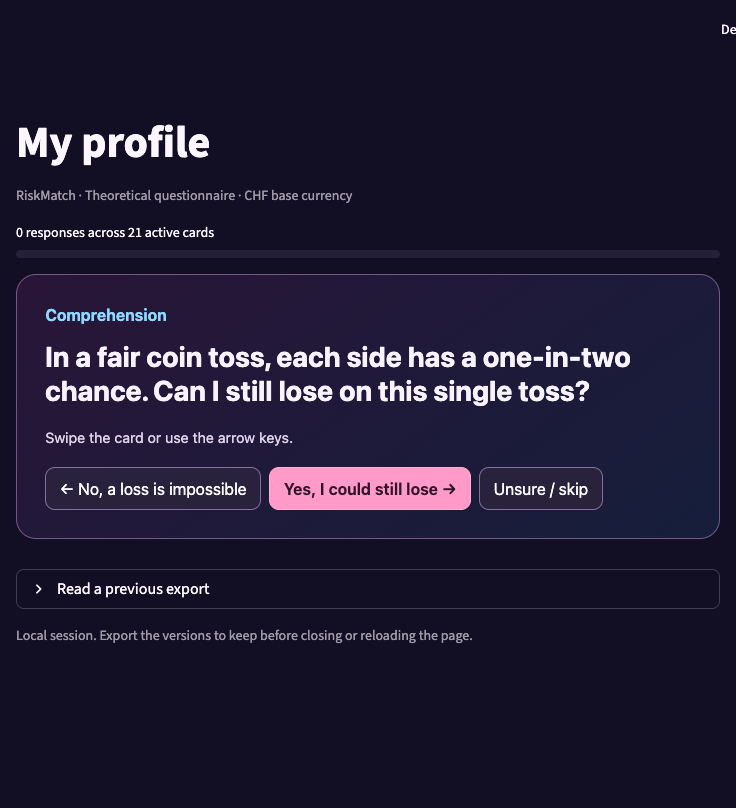

# 2 · Swipe to mandate

Questionnaire V2 contains **41 cards versioned**. Twenty-six explore seven cognitive and behavioural families. Fifteen collect economic facts, objectives and preferences. Visible cards depend on the answers. The customer can pass each card, review a response, check the synthesis and then export the version that he confirms. The engine records financial capacity, wishes, behavioral observations and uncertainties separately.

[The 41 questions, their answers and rules](CARDS.md) · [Bank JSON 2.0.0](../../src/riskmatch_v2/questionnaire/banque.json) · [Seven theoretical cases](cas.json) · [Executable analysis](../../RiskMatch_V2.ipynb)



## Calculate what the answers allow

**One-year gamble.** A client considers a fair gamble paying CHF 900 or CHF 1,200 on CHF 1,000. Its mean return is 5% and its variance is 0.0225. Under the one-year model U = μ − φσ²/2, preferring a certain CHF 1,020 (2%) gives φ ≥ 2 × (0.05 − 0.02) / 0.0225 ≈ 2.67. Preferring the same gamble to a certain CHF 1,000 (0%) gives φ ≤ 4.44. Together the choices imply 2.67 ≤ φ ≤ 4.44 for this stake and horizon. Other stakes or inconsistent answers can change the inference.

A persistent passage or incomprehension leaves the bet without contribution. An empty interval retains the status "contradiction" and proposes a correction. Choices around the starting amount, reported tolerance and follow-up responses feed into separate observations. The seven cases are fictitious. Psychometric validity among participants remains unknown.

**A reservation dated.** A household has 50,000 CHF and must pay 15,000 CHF before the protection horizon. He can invest CHF 35,000. The three fictitious customers who would sell after a drop here have exactly the same flows. The reservation therefore remains the same for all three. If one corrects his bill to CHF 22,000, his investment sleeve goes down to CHF 28,000.

The engine takes the maximum cumulative deficit up to and including the horizon. On an equal date, it protects the withdrawal before counting the contribution. An uncertain contribution is discarded. Uncertain expenditure contributes to the upper boundary of the reserve. The investment sleeve combines the limits of capital with the opposite pillars of the reserve, with a floor at zero and a visible deficit. An unknown flow date, a past stream to check or a necessary conversion to CHF keep the calculation on hold. A withdrawal after the horizon is kept in the schedule.

**Two customers with the same φ.** The customer, who must exclude thermal coal, retains a constraint to check before any proposal is made. A customer who prefers a lower carbon intensity retains a flexible criterion and a rule for missing data. The perimeter, force and priority remain available for the engine of the following sections.

## From the sales ground to the next question

| Response after a 15% decrease | Further in the portrait | What can change the mandate |
|---|---|---|
| "I need to pay an expense." | D02 records the need for liquidity. F03 collects the amount, currency, certainty and date. | Only the reported flows are included in the reserve calculation. An expense mentioned but absent from F03 triggers a clarification. |
| "Even my expenses covered, the loss makes me uncomfortable." | D03 records a preference for stability. | Section 3 may propose loss scenarios and confirm the risk band. |
| "I think the market will fall further." | D04 records an opinion and D05 asks if a comparison with cover interests the customer. | A request for coverage can be specified in P09. The opinion remains separate from the measured forecasts. |

## Route and version rules

The engine runs through the bank in the order of identifiers **as recorded in the JSON**. Each condition reads only previous active responses. An unconditional card belongs to the common route. Upon correction, the inactive descendants disappear from the current calculation. The history keeps the dated entries and the exported versions retain their original portrait.



The graph illustrates the main bifurcations. The guide details each condition and destination. Export reading uses the schema number. The confirmation relates to the transcription of the portrait, including its unknowns. Each export keeps `allocation_authorized=false`. A correction reopens the current version. The acceptable band and its financial adequacy fall under Section 3.

## Open and verify



From root V2, install the package and open the questionnaire with the same Python environment.

```sh
python -m pip install '.[questionnaire]'
python -m streamlit run app/questionnaire.py --server.address 127.0.0.1
```

The application keeps the answers in the local session. JSON export allows you to reopen an old read-only version. The "My Profile" page of the visual prototype contains a link to local service on port 8501. [Open My Portrait](http://127.0.0.1:8501)

The logic tests run with `python -m unittest discover -s tests -v`. They check each accessible card, the routes of clarification, the boundaries and their sensitivity, the flows, the preferences, the corrections and the reading of an old version. The interface check uses the Chrome and Playwright 1.55.0 browser with active service. The command `python tests/parcours_navigateur.py` Replays the keyboard, buttons, double interaction, input streams, export and a correction on the computer. The second route uses touch events on an emulated mobile screen, including a short gesture and cancellation. [Engine tests](../../tests/test_interview.py) · [Browser path](../../tests/parcours_navigateur.py)

Conceptual references are the mean-variance criterion for arbitrations and the role of the reference point for profit and loss formulations. The rules of the questionnaire are design assumptions to be tested. [Markowitz, *Portfolio Selection](https://doi.org/10.1111/j.1540-6261.1952.tb01525.x) · [Kahneman and Tversky, *Prospect Theory*](https://doi.org/10.2307/1914185)
