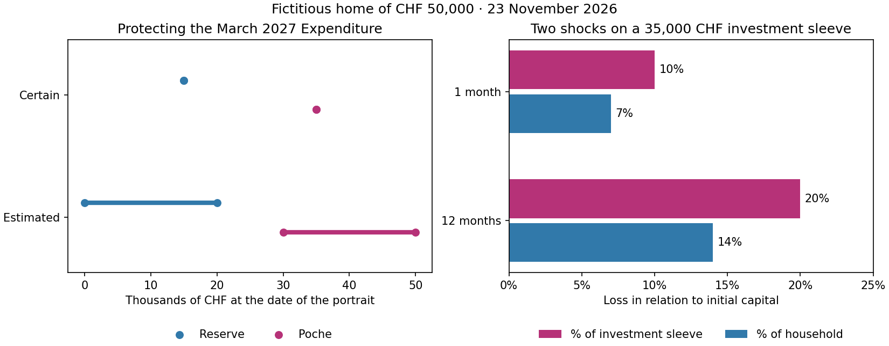

# 3 · What volatility does the customer accept?

Upon confirmation of the questionnaire, the client returns his initial request, sees examples of loss in CHF, and can confirm, modify or defer his choice. The exported portrait retains the request of the questionnaire, the one finally entered, the base, the reasons for clarification and the financial limits. The results below relate to eleven fictitious cases in the **23 November 2026**. [Open local application](http://127.0.0.1:8501) · [Case](cas.json) · [Calculated results](resultats.json) · [Notebook](../../RiskMatch_V2.ipynb)

## 3.1 · Read the bounds

| Dialogue benchmark | Annual investment sleeve volatility in CHF |
|---|---|
| Very cautious | 0% included to less than 4% |
| Cautious | 4% included to less than 8% |
| Moderate | From 8% included to less than 12% |
| Growth-oriented | 12% included to less than 20% |
| Aggressive | From 20% inclusive |

These names describe an exposure. The customer can keep a custom volatility band **6–10%**, even if it covers two landmarks. A custom band includes its two bounds. A target of 40% with a margin of two **points** becomes 38-42%. A ceiling of 100% is recorded as 1.00 in decimal units. The export specifies the unit, currency, period and base. The high open bound of a named slice remains identifiable. [Dated Configuration](../../src/riskmatch_v2/questionnaire/risque.json)

## 3.2 · Distinguish preference and feasibility

| Request seized | Registered decision |
|---|---|
| Minimum risk | Then look for the minimum permissible volatility option. The minimum achievable value remains to be calculated. |
| Ceiling 35%, 40% or 100% | The high bound remains available for the Feasibility Engine. A lower volatility portfolio can respect it. |
| Target 38-42% | Both points count. A demonstrated maximum of 18% excludes this target under the same assumptions. |
| Indecision | Save the open application and keep the ranking pending. |

The original proposal is based on P02–P04. If demand is missing and D03 indicates a preference for stability, the screen proposes to examine the minimum risk. The client keeps his hand. The φ estimate from the gambles stays with the client profile. The methodology distinguishes between the financial situation, loss capacity and declared tolerance. These principles guided the design. [ESMA guidelines on adequacy, paragraphs 12 and 23–24](https://www.esma.europa.eu/sites/default/files/2023-04/ESMA35-43-3172_Guidelines_on_certain_aspects_of_the_MiFID_II_suitability_requirements.pdf)

In two pedagogical cases, it is assumed that the maximum possible has already been demonstrated at 18%. This limit is sufficient to exclude target 38-42%. With a ceiling of 40%, the study remains open. The engine controls the attitude, date, version, checksum of the portrait and the presence of a reference of evidence. The current application does not have any certified market bounds to provide. Section 5 will have to produce that of the mandate and universe actually studied.

## 3.3 · Explaining conflicts

The screen presents the client with two questions after the scenarios. Will he be able to pay his expenses? Will he agree to keep his investment sleeve after the drop? The responses and financial reasons remain distinct. The deadlines in the protection horizon are displayed for a high target. A near-expenditure out of this horizon or a target in the first year require clarification.

In the 38-42% target example, the household reported a difficulty threshold of between CHF 4,000 and 6,000 in F04, a stability preference in D03 and an invoice as at March 31, 2027. The 20% shock on the investment sleeve would amount to 7,000 CHF. The customer prefers to sell in this scenario. Its demand remains at 38-42%, the 15,000 CHF reserve remains protected and the state is **to be clarified**. The minimum risk is proposed for comparison. It may review or retain its original application pending.

The "high target" dialogue threshold corresponds to a low bound of at least 20% on the investment sleeve. Where the request relates to the home, comparison is possible if the share invested is known. A simple high ceiling also allows lower exposures. Examples of loss are assumptions independent of the volatility requested. They do not establish any probability of decline.

## 3.4 · See CHF available

For the fictitious household with CHF 50,000 and having to pay CHF 15,000, the investable balance is CHF 35,000. Under the assumption of a fixed nominal reserve, this investment sleeve represents 70% of the initial capital. A 40% volatility cap on the investment sleeve is then equivalent to 28% on the home at that time.

| An independent hypothetical example | Loss in CHF | Part of initial investment sleeve | Share of initial household |
|---|---:|---:|---:|
| Accumulated decrease from 10% to one month | 3,500 | 10% | 7% |
| Cumulative 20% decline at 12 months | 7,000 | 20% | 14% |

The figure uses a constant initial exposure to compare denominators. The cash schedule deals separately with inputs and outflows. By investing the low bound of the investment sleeve on the initial date:

| Expenditure as at 31 March 2027 | investment sleeve calculated on 23 November 2026 | Original cash retained | Cash after expenditure |
|---|---:|---:|---:|
| 15,000 CHF certain | 35,000 CHF | 15,000 CHF | 0 CHF |
| Possible expenditure from 10,000 to 20,000 CHF | 30,000–50,000 CHF | 20,000 CHF | 0–20,000 CHF |

In the second case, the expenditure may also not take place. The reserve requested is therefore between CHF 0 and 20,000. The uncertain amount retains the status "to be clarified". If all the capital is protected, the investment sleeve sucks. If the date of a necessary withdrawal is missing, the encrypted examples remain unavailable.

## Reproduce and reread a decision

Launch the local questionnaire from V2 with `python -m streamlit run app/questionnaire.py --server.address 127.0.0.1` after installation of the option `questionnaire`. Confirm responses, then open the risk decision on the same page. The export of Figure 2 retains a reference to the version of the portrait. An expense correction or preferably reopens the portrait and requires further confirmation. The exports in Figure 1 remain legible.

From root V2, `jupyter execute RiskMatch_V2.ipynb` regenerates the results and figure. The logic tests run with `python -m unittest discover -s tests -v`. The Chrome app path checks 40 ± 2 input, clarification, export and return to indecision. [Calculations](../../src/riskmatch_v2/risk_review.py) · [Section tests](../../tests/test_risk_review.py) · [Browser path](../../tests/parcours_navigateur.py)
