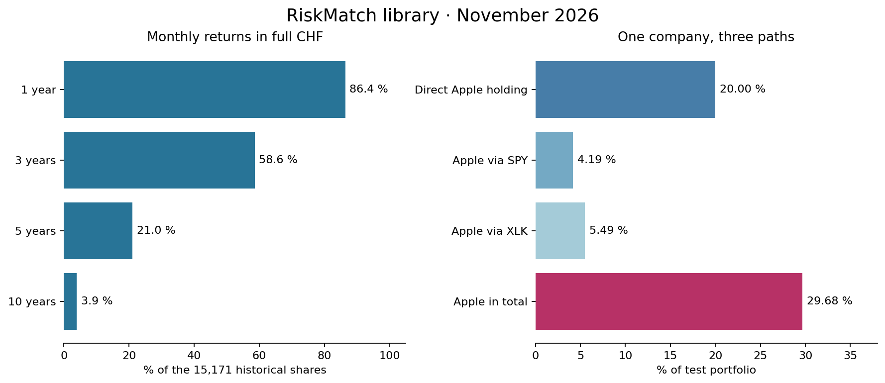

# 4 · Market Library

As of 23 November 2026 at 2 p.m. UTC, RiskMatch has **60,736 historical records** and compositions dated **12 of the 13 funds**. The application allows you to search for a title by name, symbol or identifier, examine the coverage of its measures in CHF and read the reason for its eligibility decision.



## 4.1 · What assets do we have?

| Source and role | Content of this vintage |
|---|---|
| CRSP Monthly Stock File, Local Extraction 1998–2025 | 27,421 securities identified by PERMNO. For each month, the equity filter requires an ordinary share, an American issuer and a NYSE, AMEX or Nasdaq place. 15,171 titles satisfied the filter at a time of history. 14,136 are ranked shares at their last qualified observation. |
| Instruments listed in the United States, priced in USD | SPY and nine sector funds XLB, XLE, XLF, XLI, XLK, XLP, XLU, XLV, XLY. IEF and TLT for Treasury securities. GLD for gold. Each fund has 5,505 prices sessions in the file. |
| US Treasury issues | 65 Separate ISINs identified in the positions of the IEF and TLT. Each issue has an indicative observation of funds. Total history per issue remains to be obtained. |
| Factors and references | WTI spot in USD, 10-year Treasury rate, CHF change for 1 USD, consumer prices, industrial production and unemployment. Cash CHF to qualify for the account and 60/40 internal reference for comparison. |

The inventory comprises 27,507 entries. A symbol may change or be reused. Historical searches go through identifiers and their validity dates. Several observations in the same month may describe different distributions. The 2,639,046 gross lines CRSP give 2,594,465 single-identity monthly observations. The quarantine register isolates 13,520 titre-month couples with no usable dated identity or incompatible versions. Raw files are kept to examine other lines of the same month. [Tables diagrams](schemas.json) · [Imprints and sources](../../config/sources-4.json)

## 4.2 and 4.3 · From the session to the sheet

The return in CHF multiplies the return factor in USD by the final and initial CHF/USD price ratio. An investment winning 4% in USD when the dollar goes from 0.90 to 0.81 CHF thus loses 6.4% in CHF. The schedule of American sessions, including closures, distinguishes a holiday from an absent prices. The two returns that depend on a missing exchange remain unknown. Of 71,565 fund-session couples, 70,161 have a CHF return that can be used.

The register includes 1,389 dividends and six splits of funds. For each dividend, the pipeline brings forward before/after and dividend into line with the supplier's adjusted return. 1,387 deviations are up to 10 basis points, two exceed the control threshold. The private register keeps both estimates and the signed deviation. The sheets follow the supplier's adjusted series. The management costs incurred in the value of the fund are already reflected in the observed performance. Their isolated amount, taxation and actual account charges remain unknown.

| Window | Shares, all observed CHF returns | Shares, computable compound growth | Funds, CHF returns observed per fund |
|---|---:|---:|---:|
| 1 year | 13,105 | 13,676 | 12 / 12 |
| 3 years | 8,885 | 10,208 | 36 / 36 |
| 5 years | 3,188 | 7,645 | 58 / 60 |
| 10 years | 596 | 4,424 | 118 / 120 |

Each window covers 15,171 action sheets and 13 background sheets. The shares end with their own last qualified observation, the funds as of 30 October 2026. A continuous chain of local returns and exchange rates at both ends are sufficient to measure compound growth, even if an intermediate exchange rate is lacking. Variance and correlations require the corresponding monthly returns. The sheet gives the number and dates with each calculation. The maximum decline relates to valuations observed at the end of the month. Recovery is counted in calendar days from the top, with also duration from the bottom. An intra-monthly fall may be stronger. [Calculations, units and conditions by class](METHODS.md)

From January 2023 to December 2025, 3,404 series have 36 monthly returns in common CHF, i.e. 3,391 shares and the 13 funds. The matrix is conditional on present and active shares in December 2025. Compared to the candidates in this comparison, 433 series have a hole. The rank of empirical covariance is not more than 35. This matrix describes the movements observed together. The stable estimate required for optimization is 5.1.

## 4.4 and 4.5 · What could have been proposed?

In December 2025, CRSP recorded 3,826 shares in the last month, of which 3,824 were active. Apple, PERMNO 14593, is included. The extraction is dated October 2026. It allows to reconstruct Apple's history, but the version actually available to the decision maker in December 2025 remains unknown. The outputs and distributions remain in the observations. An amount of undocumented terminal cash remains unknown.

For the decision of Monday 23 November 2026 before the US opening, the last closed session is Friday 20. The prices of the funds stopped on 18 November, the exchange on 13 November and the CRSP shares at the end of 2025. The bond positions of the 20th only give an indicative valuation. No account or implementation schedule is documented. **Zero instrument passes all checks**. The register of each title shall indicate the information to be obtained. Factors remain available for research. [Versioned rules](../../config/catalogue-4.json) · [Numbers by class and reasons for the Apple example](resultats.json)

To compare managements, catalogue prices independently reproduce the last continuous segment of section 1.4, February 2022 to October 2026. With 100 CHF at the start and 10 basis points per processed amount, the 60/40 SPY–IEF ends at 124.32 CHF in annual rebalancing and 128.41 CHF in conservation. The 0% cash reference ends at CHF 100. These amounts are historical. [Assumptions, dates and calculation of costs](../01-4-references/README.md)

## 4.6 at 4.8 · Methods, checks and dates

The matrix shows the calculations performed, the class-specific measurements and the entries still required. Control cases include a reused sticker, a write-off, too recent introduction, dividend split, market closure, reverse FX, unfinished recovery and subsequent revision. The economic date, the session and the first verifiable availability are distinct. For prices and changes, the download limits the availability of the complete file. For the ALFRED series, each version is filtered according to its own availability. A late publication or revision does not replace any value in an already frozen view. The views of 31 December 2025 and 23 November 2026 are retained. [Methods matrix](METHODS.md) · [Check cases](../../tests/test_library.py)

## 4.9 · The same company behind three lines

In the trial portfolio, 50% go to SPY, 30% to XLK and 20% directly to Apple. The positions of November 20, 2026, consulted on the 23rd before the calculation, add **4.19 points** via SPY and **5.49 points** via XLK. Apple therefore represents **29.68%** of the portfolio. A firm exclusion from Apple removes this composition. Approximately 0.11% of the portfolio remains unallocated in net terms and 0.12% in gross exposure unknown. The method retains the rounded residue and lines without identity. For GLD, the detailed composition validated is missing. The unallocated share is therefore 100% in this control. A risk or exposure at this location remains unknown. Sectors come from classifiable positions and currencies are line currencies. The issuer code distinguishes the issuing entity, without proof of attachment to an ultimate parent company. [SPY positions](https://www.ssga.com/library-content/products/fund-data/etfs/us/holdings-daily-us-en-spy.xlsx) · [XLK Positions](https://www.ssga.com/library-content/products/fund-data/etfs/us/holdings-daily-us-en-xlk.xlsx) · [Accurate sources and versions](../../config/sources-4.json)

## Reproduce and Consult

From the root V2, with Python 3.12 and both sets of vintage sources in `data/local/1.3/raw/` and `data/local/4/raw/`, perform the following commands. The relationship between managers' positions evolves over the course of the sessions. The fingerprint identifies the exact file.

```sh
python -m pip install '.[catalogue,questionnaire,notebook]'
python -m riskmatch_v2.library.build
python -m unittest discover -s tests
jupyter execute RiskMatch_V2.ipynb
streamlit run app/questionnaire.py
```

Open **Catalogue** in the sidebar of the application. The detailed tables and the NumPy matrix are located under `data/local/4/4.0-2026-11-23/`. A re-launch checks the fingerprints of the entries and products. On a GitHub copy alone, the notebook and Catalogue page present the aggregates and figure. [Notebook](../../RiskMatch_V2.ipynb) · [Journal](../../JOURNAL.md)

**Extension of the stock library.** A complementary archive connects the series to October 30, 2026. The Catalogue page shows the status and returns of each action found. [Coverage, sources and inventory](../actions-2026/README.md)

**Transversal control of sections 1 to 6.** As of October 30, 2026, the multi-asset study submitted 3,322 securities, including 3,255 individual stocks, 54 direct Treasuries and 13 ETFs. Previous comparisons of 13 ETFs are used as a control. [Multi-asset report](../univers-complet/README.md) · [Evidence by box](../univers-complet/AUDIT.md)
