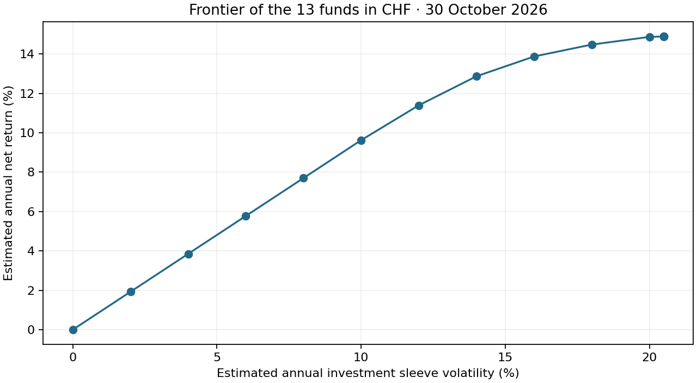
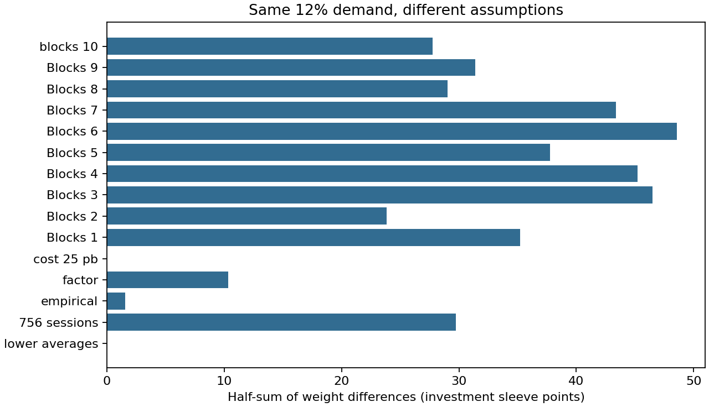

# 5 · Which allowance meets the risk request?

With a 13-fund research mandate, the **maximum estimated volatility reached 22.18%** on the investment sleeve in CHF on October 30, 2026. A client who fixes a **ceiling of 40%** leaves the engine the choice of a less risky portfolio. The model uses 20.50 per cent volatility for an estimated annual net return of 14.90%. One **Target between 38% and 42%** is out of reach with these same assumptions. The results are derived from historical estimates and assumed costs. For the actual account dated November 23, no line crosses all eligibility checks.



## 5.1 · Where does the client and data enter?

Section 3 provides the confirmed claim, its basis of assessment and the amount protected. The admission check checks the date of the portrait and the date of the register, rereads the request and reconverts, if necessary, a bound of the household to the end of the investment sleeve. In our example, CHF 50,000 of capital and CHF 15,000 protected give 35,000 invested. A volatility of 14% of the household is equivalent to 20% of the investment sleeve if the reserve in CHF is fixed. Portfolio constraints are provided to the engine as initial positions, bounds and exposure factors. A known ban sets a maximum weight at zero. A sector, issuer or currency limit is expressed by a weighted sum. Each mandatory rule is aligned with its card and perimeter. An unknown exposure suspends the calculation. The model transmitted must cover the identifiers admitted on the same date. [Transition from mandate to solver](../../src/riskmatch_v2/feasibility/account.py)

The daily returns in Section 4 include the exchange. The 504 session window ends on 30 October 2026 and has 496 full days. The individual annualized average is close to 50% of the median of averages in the same universe. The choice of a weight of 50% is a hypothesis. The first balance requires a market portfolio and defensible capitalizations for this multi-class universe. This vintage doesn't set them. Management fees already included in fund prices remain in historical performance.

The reference uses Ledoit–Wolf. Empirical covariance and decomposition by SPY, IEF and GLD factors are also assessed. Three blocks of 63 post-estimate sessions compare the expected volatility with that of an equal-weight portfolio, for windows of 504 and 756 sessions. The notebook displays the errors. These test dates are distinct from the estimated dates. Adjusted prices come from later extraction, which limits the evidence of historical availability. [Parameters](../../config/faisabilite-5.json) · [Ledoit–Wolf](https://scikit-learn.org/stable/modules/generated/sklearn.covariance.LedoitWolf.html)

## 5.2 to 5.4 · Calculate, prove, verify

Weights are fractions of the initial investment sleeve. The annual net return estimates the sum of the weighted individual returns, minus the initial costs divided by the horizon in years. The residual cash is paid at 0% in the experience. Purchases and sales carry 2 bps of commission, 3 bps of half spread and 5 bps of exchange. No borrowing, maximum 60% per fund and maximum 90% in total. The investment sleeve is initially in CHF. The financing of purchases may also prohibit the use of sales pending settlement. The external reserve remains protected.

| Request on the investment sleeve | Volatility achieved | Estimated annual net return | Reading |
|---|---:|---:|---|
| Minimum | ≈ 0% | ≈ 0% | Cash authorized and no minimum investment in this case of research |
| Ceiling 8% | 8.00% | 7.70% | Approximately 28.27% cash in the investment sleeve after costs |
| Ceiling 12% | 12.00% | 11.40% | Six funds have a weight greater than 0.01%, 9.91% cash after costs |
| Ceiling 40% | 20.50% | 14.90% | The ceiling leaves a margin of risk |
| Range 38-42% | — | — | The proven maximum is 22.18 per cent. Even the lower end exceeds this maximum of 15.82 points |
| Ceiling 12%, two funds excluded | 12.00% | 9.25% | Exclusions of the two largest weights from the first result reduce estimated return |

Convex optimization uses CLARABEL. HiGHS tests linear constraints. Independent control recalculates each weight, risk, expense, balance and limits with a tolerance of 0.000001 by weight. A risk cone support hyperplane provides linear relaxation. Multipliers and box bounds give a higher limit of return. For the minimum risk, a lower bound obtained by hyperplane shall be tested separately.

The maximum risk of the above mandate is verified on its 170 summits. If an optimum under ceiling lacks the low bound, the search tests segments and subdivides the weight intervals. A box is discarded if its risk limit is too low or if its return limit is dominated. At interruption, the remaining boxes retain their bound. The research budget limits the subdivisions between resolutions. The time of an individual call to the solver depends on the size of the problem.

A two-asset check has an optimum calculation by hand. For the 10–14% band, 4/9 of the most risky title is required, giving 4.22% estimated return. The interrupted candidate is kept with his or her deviation. On the true SPY–IEF series, an independent grid at a 0.1 point of weight returns the efficiency of the solver to about 0.18 bp. [Engine](../../src/riskmatch_v2/feasibility/engine.py) · [Independent audits](../../src/riskmatch_v2/feasibility/diagnostics.py) · [CVXPY Solvers](https://www.cvxpy.org/version/1.7/tutorial/solvers/index.html)

## 5.5 · Transfer funds to the library

The historical test of December 31, 2025 examines the **3,824 actions** then marked active in monthly extraction, plus the **13 fund**. A strict intersection of the 3,837 series leaves only six common dates out of 504. The factor model retains **3,676 series** with at least 252 CHF returns usable on factor dates. The remaining 161 are archived with their staff. The daily join requires adjacent sessions, an observed change and an identity within the monthly perimeter. All series at estimated risk are submitted together. The model stores three common factors and one residual variance per instrument. This structure ensures a positive semi-defined covariance and avoids storing a dense matrix for the solver. On the equivalent investment sleeve of the 13 funds and the same history, the risk is 13.22% under empirical covariance and 12.81% under factor model.

The estimated return of the 12% solution in the grand universe is 48.75% in the calibration sample. Selection from thousands of averages is highly sensitive to extreme values and error of estimation. This value is used for the calculation test. The off-sample validation at this stage is about fund volatility, not the future performance of this selection. The population of December 2025 is reconstructed from files obtained in 2026.

The notebook gives three repetitions per size, median, worst duration and peak memory of the process during resolution. For the actual decision, the 27,507 entries in the register are reviewed, zero is admissible and no orderly passage is produced. The data archive depends on the vintage, checksums and software versions. The solution key also takes into account positions, costs, exposures, limits and risk demand.

## 5.6 and 5.7 · Stability and Level of Evidence



Of ten resamples of the same dates in blocks of 21 sessions, half of the weight deviations from the reference allowance range from **23.8 to 48.6 investment sleeve points**. The estimated return ranking of three fixed portfolios changes in 6 of the 16 models. The weight of the 12% reference case is therefore sensitive. A search variant chosen from the recalculated and resized portfolios meets 12% in each of the 16 models. Its lowest estimated return overall is 8.27 per cent. The 16 models define the field of this control.

**Optimal to published accuracy** means that the candidate passes the checks and the performance gap at the bound is not more than 1 pb per year. **Candidate** keeps the weights checked and a remaining uncertainty. **Impossible** calls for evidence of constraints or risk. **Inconclusive** indicates insufficient research for these claims. An empty account filter receives its own status. [Aggregate results and certificates](resultats.json)

## 5.8 · From weights to quantities

A simulation of CHF 1,000 results in six units of the first asset and seven units of the second asset, CHF 0.86 in fees and CHF 139.64 in final cash. Another case requires at least 40% of a 500 CHF bond investment sleeve. A fictitious batch of ten units at 100 USD and 0.90 CHF/USD costs 900 CHF before fees. No eligible quantity meets this mandate. With agreement on the lifting of this minimum, the CHF 500 can remain in cash in the simulation. The tests also verify pre-settlement funding and an initial position already in an irregular batch. [Calculation of batches](../../src/riskmatch_v2/feasibility/orders.py)

## Reproduce and find results

From the root V2, with Python 3.12, the private data of Section 4 and daily extraction CRSP under `data/local/5/raw/crsp_dsf.csv` corresponding to the configured checksum:

```sh
python -m pip install '.[catalogue,faisabilite,notebook,questionnaire]'
python -m riskmatch_v2.feasibility.study
python -m unittest discover -s tests
jupyter nbconvert --to notebook --execute --inplace RiskMatch_V2.ipynb
streamlit run app/questionnaire.py
```

Page **Feasibility** the application allows to modify the ceiling, slice and exclusions and verify the result. The full identifiers, individual weights, solver entries, search logs and admission receipts remain in `data/local/5/<version>/<snapshot>/`. The corresponding keys are listed in the published JSON. Tables and graphs are recorded in the notebook, including on the GitHub copy without private data. [Notebook](../../RiskMatch_V2.ipynb) · [Checklist](../../CHECKLIST.md)

**Transversal control of sections 1 to 6.** As of October 30, 2026, the multi-asset study submitted 3,322 securities, including 3,255 individual stocks, 54 direct Treasuries and 13 ETFs. Previous comparisons of 13 ETFs are used as a control. [Multi-asset report](../univers-complet/README.md) · [Evidence by box](../univers-complet/AUDIT.md)
