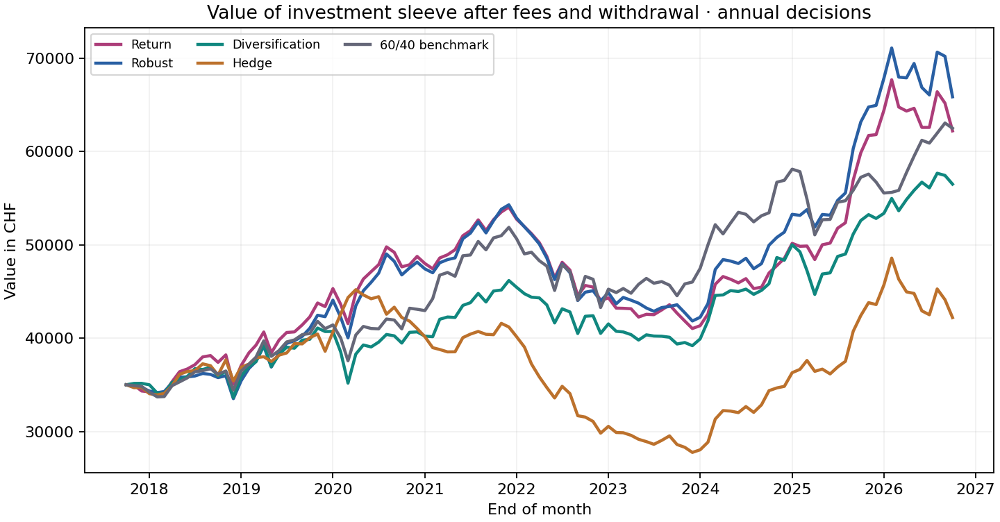
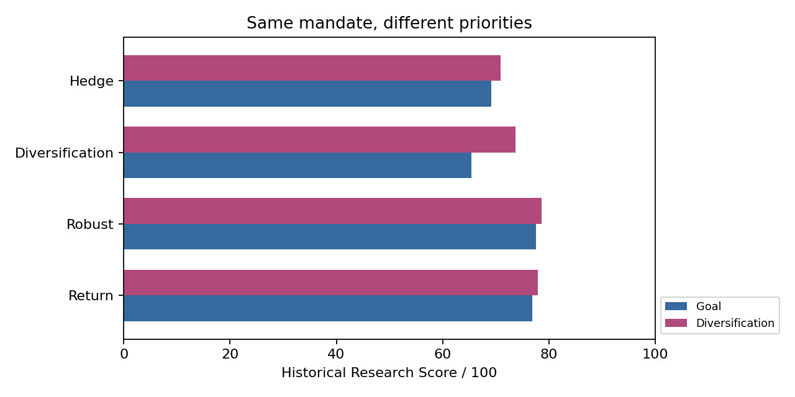
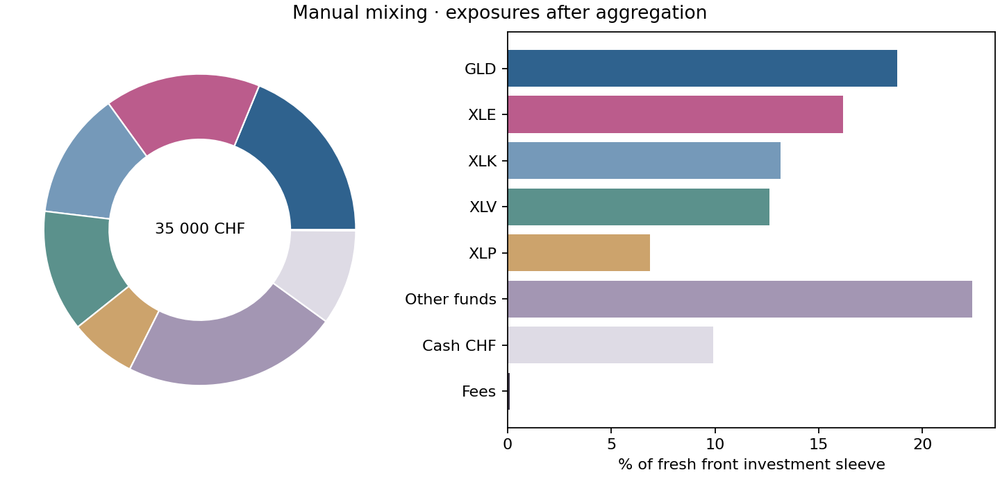

# Benchmark study of 13 ETFs

The [ETF benchmark notebook](ETF_Benchmark.ipynb) reproduces this smaller historical experiment. Section 6 of the main notebook and the Options screen use the [multi-asset results](../univers-complet/README.md).

As of October 30, 2026, four separate compositions respect the volatility ceiling **estimated** 12% of the investment sleeve. The illustrative case starts with 50,000 CHF, including 15,000 CHF reserve and 35,000 CHF investment. It authorizes 90 per cent of the fund investment sleeve and up to 60 per cent per fund. The desired return of 6% per year serves as a benchmark for the score. The data common to the game cover 13 US ETFs, including equity funds, Treasury securities and Gold. The individual bonds and stocks of the library remain available for their respective studies. On 23 November, **0 of the 27,507 instruments under review** pass all account checks. The classification below concerns historical research. [Assumptions](../../config/options-6.json) · [Eligibility checks](../05-faisabilite/README.md)

## 6.1 and 6.2 · Choice and compromise

| Option | Estimated annual net return | Estimated annual volatility | Annualized net replay return | Loss if 2008 shock repeats | HHI concentration |
|---|---:|---:|---:|---:|---:|
| Return | 11.40% | 12.00% | 6.83% | 16.13% | 0.177 |
| Robust | 11.25% | 11.83% | 7.51% | 15.48% | 0.175 |
| Diversification | 8.90% | 11.98% | 5.73% | 23.03% | 0.075 |
| Hedge | 8.90% | 12.00% | 2.40% | -3.28% (gain) | 0.359 |
| Fixed reference 60% SPY / 40% IEF | 8.03% | 12.76% | 6.72% | 15.80% | 0.520 |

The Performance variant maximizes estimated annual after-cost returns. Robust maximizes the lowest estimate among three models, under their three risk ceilings. Two Ledoit–Wolf covariance models use 504 or 756 sessions, the third an empirical covariance over 504 sessions with a greater reduction in mean performance. The range displayed ranges from the smallest to the largest estimate. It measures the sensitivity to the model. The variance and contributions of each fund are calculated on the same returns in CHF. The estimated Sharpe uses an assumed zero CHF reference rate. [Calculation of variants and indicators](../../src/riskmatch_v2/options/compare.py)

Diversification minimizes the sum of squared weights, including liquidity. Cover is looking for the composition that would have gone through the shock from 12 September to 20 November 2008. These two objectives can return up to 2.5 points of estimated annual return compared to the first option. Similar weights are grouped from half the sum of absolute deviations (0.5 per cent threshold). The four options remain distinct. The reference exceeds both the authorized amount of funds and the risk ceiling. It remains visible for comparison.

Fund diversification may mask common positions. The form also gives the first identified transmitter and the unknown fraction. For Robuste, the U.S. Treasury accounts for at least 5.70% of the investment sleeve and 26.15% remain unattributed to an issuer. This reading uses a publication from November, after calculating the weights of October. It is only used for diagnosis. The environmental option expects a measure and coverage validated in step 11. [Data sheets and weights](resultats.json)

## 6.3 6.5 · Replay and conditions of execution



Nine annual decisions use the last session of October, from 2017 to 2025. Allocation parameters are recalibrated on the observations available up to each decision. Weights drift between two rebalancings. The replay ends on October 30, 2026. The series have been collected retrospectively and do not prove which versions of the data were disseminated at each date.

Central execution uses the closing of the next session and a unit cost of 10 basis points (0.10% of the amount exchanged). Dividends are credited on the ex-dividend date by agreement due to lack of payment schedule. The model deals with securities divisions, daily conversion into CHF and costs on net orders. The supposed settlement takes place one session after execution. An executed sale can thus leave purchases waiting for financing. A missing price or exchange prevents execution. The last known valuation is used only to assess positions already held. Each day, positions, available cash and amounts to be settled are reconciled with net worth. [Register of transactions](../../src/riskmatch_v2/options/replay.py) · [Cases checked](../../tests/test_options.py)

| Final richness of the investment sleeve, rounded CHF | Free of charge | 10 bp | 25 bp | 50 bp | One more delay session | First missed basket | Whole shares |
|---|---:|---:|---:|---:|---:|---:|---:|
| Return | 62,643 | 62,219 | 61,586 | 60,544 | 60,761 | 57,752 | 62,073 |
| Robust | 66,232 | 65,871 | 65,332 | 64,442 | 64,879 | 64,014 | 65,702 |

The 35 rejeux cross five allocations and seven assumptions on the same market, with the same withdrawal requested of CHF 1,000 on 31 March 2022. The reserve remains separate. At central cost, the four variants pay for the entire withdrawal. The reference pays only CHF 272.86 on its available liquidity. Its final wealth therefore includes a portion of the requested withdrawal still unpaid. The final values, cumulative costs, turnover rates, withdrawals served, reconciliation differences and exceedances of the realized volatility ceiling are available for all 35 cases. [Assumed results](resultats.json)

The limit applies to the election date. The return variant achieved 14.30% annualized volatility on the game. Protection depends on the impact chosen. Coverage earned 9.19% during the February–March 2020 episode and lost 25.69% in 2022. A composition can thus go through a precise shock and remain very vulnerable during another crisis.

## 6.6 and 6.7 · Adequacy to the mandate



Weights follow the objective order, historical behaviour, stress, diversification, costs, forecasts. The Objective profile uses 35/15/15/15/10/10. The Diversification profile uses 15/10/15/40/10/10. Each measure shall be reduced to 100 according to the thresholds set out in the scale. Historical behaviour combines annualized net return (75%) with maximum observed loss (25%). The mandatory criteria and the necessary data are checked before assigning a rank. [Scale](../../config/options-6.json) · [Calculation of contributions](../../src/riskmatch_v2/options/scoring.py)

The macro, market, quantitative and sentiment families remain displayed separately. Pending validation of CHF return at 12 months (Step 12), the historical grid covers 90% of the expected weight. All options share the same criteria available, restandardized to 100. For the Objective profile, Robust gets 77.52 and Performance 76.88. The gap of 0.64 points places them in the same group, below the margin of two points set at the beginning. For the Diversification profile, the diversification variant is increased from 65.44 to 73.76. It remains penalized by the loss of the scenario. The book also reproduces cases of complete fictional coverage, missing feeling, exclusion, missing essential data and reversal between two close options. [Detail of scores and sensitivities](resultats.json)

## 6.8 and 6.9 · Divide a investment sleeve between several options



The manual choice of **60% Performance + 40% Diversification** gives 10.40% of estimated net return, 11.68% of estimated volatility and 6.45% of annualized return on the game. The calculation consolidates common securities and compensates for purchases and sales before measuring fees. For example, a 20 per cent and 10 per cent title in both options weighs 16 per cent in the mixture. The engine rechecks the risk band, positions, concentration and score, including after rounding to the entire parts.

Among Performance, Diversification and Coverage, Sharpe's free research proposes **92.8% return and 7.2% Coverage**, for a Sharpe estimated at 0.951. The minimum volatility found combines approximately 50.1% Diversification and 49.9% Coverage for 10.37 percent volatility. With the only performance criterion, the entire investment sleeve returns to return. The book table compares eleven choices, including options alone, equal weighting and a minimum share of 10% per option. Multipoint digital search produces a reverified candidate on positions. Overall optimality remains to be demonstrated. [Comparisons and rounding](resultats.json)

## Reproducing and Exploring

From the root of V2, install dependencies and then open the page **Options** of application. The public copy contains the outputs of the book and the eleven reference mixtures. The catalogue's local archives allow testing of other parts, exclusions or slices, and replaying the nine decisions.

```sh
python -m pip install -e '.[catalogue,faisabilite,notebook,questionnaire]'
python -m riskmatch_v2.options.study
jupyter nbconvert --to notebook --execute --inplace RiskMatch_V2.ipynb
streamlit run app/questionnaire.py
```

The study command uses the local entries in Section 4 and checks their fingerprints. Daily records, orders, positions and annual targets are available in `data/local/6/<version>/<empreinte>/`, accompanied by a verifiable manifest. The public notebook rechecks, scores and figures from the aggregate results. [Notebook, sections 6.1–6.9](../../RiskMatch_V2.ipynb) · [Options Page](../../app/pages/4_Options.py)

The four options in this report use the 13 ETFs. A subsequent study extended individual stocks until the same date. [Coverage of shares as at 30 October 2026](../actions-2026/README.md)

**Transversal control of sections 1 to 6.** As of October 30, 2026, the multi-asset study submitted 3,322 securities, including 3,255 individual stocks, 54 direct Treasuries and 13 ETFs. Previous comparisons of 13 ETFs are used as a control. [Multi-asset report](../univers-complet/README.md) · [Evidence by box](../univers-complet/AUDIT.md)
