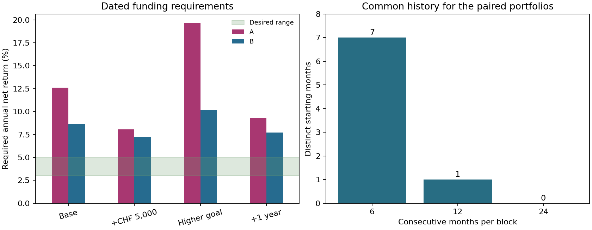

# Can the portfolio fund the client’s dates and goal?

Two theoretical clients start with CHF 50,000 on the research decision date, 30 October 2026. Their behavioural answers, stated 3–5% desired annual return, confirmed 12% annual sleeve volatility cap and CHF 15,000 expense are identical. A pays the bill in March 2027 and wants CHF 50,000 in October 2029. B pays in March 2030 and wants CHF 75,000 in October 2034. These future dates define scenarios. Market observations end at the decision date.

| Measure | Client A | Client B |
|---|---:|---:|
| Protected reserve / investable sleeve (CHF) | 15,000 / 35,000 | 0 / 50,000 |
| Required annual net rate, dated flows | 12.61% | 8.62% |
| Required rate with CHF 5,000 added in October 2027 | 8.05% | 7.25% |
| Required rate with the goal delayed one year | 9.32% | 7.73% |
| Custom portfolio whole-lot positions | 137 | 141 |
| Estimated annual sleeve volatility after rounding | 11.19% | 11.40% |
| Estimated annual net return across section 6 model variants | 24.73–40.41% | 25.46–41.50% |

The last line measures disagreement among historical model variants at the decision date. It is neither a prediction interval nor a basis for promising either goal. Both required rates exceed the clients’ stated range. The case files give a smaller goal and the additional upfront savings needed under a constant 5% net-return assumption. These alternatives require a new client decision. [Client A](client-A.json) · [Client B](client-B.json)

## 7.1 · What return does the cash-flow schedule require?

The questionnaire and risk-review engines confirm the research mandate. The reserve protects expenses through October 2027 and earns zero interest. Only CHF amounts with known dates enter these examples. The required-rate equation compounds the **unreserved** balance and dated flows at a constant annual net rate, on an ACT/365.25 basis. A withdrawal uses the reserve first. Any unused reserve counts toward the final goal. A goal quoted in today’s francs can be increased using an explicit inflation assumption; both case files specify nominal CHF goals.

The numerical solver searches −99% through +1,000% annually. It partitions the discounted cash-flow equation at its stationary points before applying Brent’s method, so a sign-changing payment stream can yield multiple solutions, a tangent solution or no root in the search range. Unit tests cover those cases, an already funded goal, a reserve exceeding available cash, and a no-flow analytical cross-check. The notebook separately reconstructs the terminal value from the published rates. [Funding calculations](../../src/riskmatch_v2/funding.py) · [Tests](../../tests/test_funding.py)

## 7.2 · Which historical observations can be replayed together?

The custom target comes from the full 3,322-instrument section 6 model. Each client buys whole lots at the decision-date USD prices and FX; the remainder stays in CHF. The comparison portfolio is 60% SPY and 40% IEF before entry costs and rounding. It is a benchmark: it exceeds the clients’ cap and does not satisfy the model’s risky-investment limit. Both portfolios incur the same per-instrument one-way cost convention (10 bp in this study) at entry and on liquidation. Returned cash earns zero. Both portfolios use precisely the same sampled months within each paired comparison.

Monthly CHF total returns already incorporate the observed currency movement and distributions. The study samples consecutive valid months jointly across **every held asset** of both portfolios. No missing returns are filled. The model holds the initial lots, reinvests distributions through the total-return series, and keeps subsequent deposits in cash. It liquidates the entire sleeve if available cash cannot cover a payment; this explicit rule avoids fractional sales. At the terminal date, wealth includes liquidation proceeds after costs and outstanding bills. This is a monthly research convention without taxes, settlement delays or an executable broker quote. The confirmed rate calculation above describes uniform reinvestment; realized cash balances and trading costs can produce a different outcome.

| Block length | Distinct starting months in the paired study | Use |
|---|---:|---|
| 6 months | 7 overlapping starts | 2,000 seeded draws per client and scenario |
| 12 months | 1 | One repeated historical path; no probability estimate |
| 24 months | 0 | No paired result |

All seven six-month blocks come from the same twelve months, November 2025–October 2026, which overlap the period used to choose today’s holdings. The models select the constituents retrospectively. Repeated strong gains in those same holdings can compound to extreme terminal values. In the six-month draws, both custom portfolios meet their goals on all 2,000 paths. This count has **no credible interpretation as a future success probability**. As a coverage check, the benchmark alone has 97 distinct 24-month starts. For A, its six-month goal count changes from 1,796/2,000 on the paired history to 355/2,000 on the longer history. The latter comparison uses a different sample.

The study also reports flat prices, an immediate 30% decline followed by flat prices, and constant 5% annual asset growth. With flat prices, the custom portfolios’ terminal funding gaps are CHF 15,058 and CHF 40,086. Under the 30% decline they rise to CHF 23,693 and CHF 52,925. Both exercises preserve the scheduled withdrawals, entry lots, cash and costs.

Neither rounded custom portfolio holds a direct Treasury. No direct coupon or principal is added to its cash account. Each case file separately compares the contractual coupon and maturity dates of an illustrative USD 100 Treasury lot with the bill date, using decision-date FX for illustration. ETF distributions are already in their total returns. [Inputs and seed](../../config/funding-7.json) · [Source history and coverage](../econometrie/README.md)

## 7.3 · How do the client request and feasible choices differ?

Both dossiers retain the card responses, aversion bounds, confirmed risk request, reserve, rounded portfolio measures, desired and required rates and unaccepted alternatives. The expense-date-only counterfactual moves A’s bill to March 2028 and leaves the starting capital, goal and risk preferences unchanged. Each sensitivity changes a single input: a CHF 5,000 contribution, a CHF 10,000 increase in the goal or a twelve-month extension.

The risk controls replay minimum risk, a 40% cap, target bands around 35%, 40% and 100%, a mandatory direct-security exclusion and a maximum 2% direct-position weight. They recalculate the continuous full-universe frontier and verify position limits. CHF cash attains the minimum. The wide universe admits solutions for the high target bands in this model. The ETF-only controlled example supplies a separate infeasible target. A CHF 200,000 one-year goal is also compared with the full-universe model upper bound. No alternative silently relaxes the client’s limits. Actual orders remain blocked by the dated account gate. [Controls and decisions](results.json)

## 7.4 · When does a shortfall occur, and can it be recovered?

Each path records the first unpaid month and amount, the first recovery of those arrears, terminal net wealth and terminal deficit. Bills fall due before same-day contributions. Unpaid amounts carry forward until settled. Public files give counts by date, mean first missed amount when applicable, terminal quantiles, and mean and median terminal gap for each variant. An explicit regression starts with CHF 2,000, owes CHF 5,000 in month one, then receives CHF 8,000 in month two. The first gap is CHF 3,000. After settling it, CHF 5,000 remains against a CHF 4,000 terminal goal. The terminal gap is zero, but the first bill was late.

## Reproduction

From the V2 repository with the catalogue and feasibility dependencies and existing private snapshots installed, run `python -m riskmatch_v2.funding_study`. Exact holdings, lot counts and individual paired paths are written to `data/local/7/<universe snapshot>/<client>/`. The client JSON files contain aggregate results. The public [research notebook](../../RiskMatch_V2.ipynb) reads these outputs and rebuilds the figure without requiring the private archive. The [study implementation](../../src/riskmatch_v2/funding_study.py) binds the portfolio and econometric snapshots to the same decision date.
