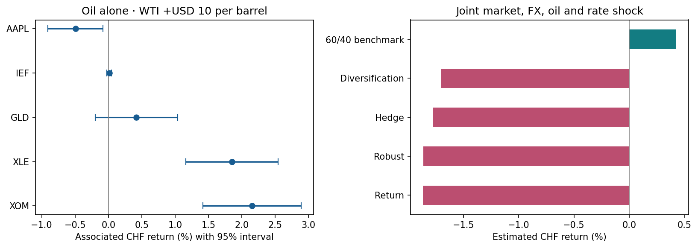
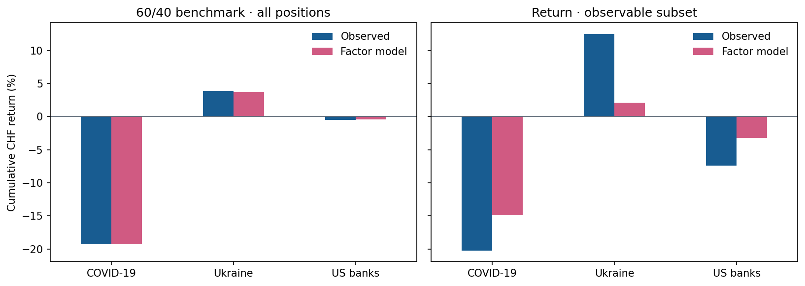

# What moves a RiskMatch portfolio?

The decision snapshot is 30 October 2026. The five-factor study covers 3,902 instruments and the four research allocations from section 6, alongside the 60/40 SPY–IEF benchmark. A sensitivity measures the historical association with one factor when the other factors are held fixed. A crisis replay measures everything that moved during that episode. Both views use CHF as the reporting currency.

## 8.1 · Factors and signed oil shocks

| Factor | Series and unit in the regressions | Date convention |
|---|---|---|
| US equity market | SPY total return in USD, expressed as a decimal | US trading session, close to close. SPY also belongs to the instrument universe. Its own market exposure is mechanical. |
| Dollar | Change in CHF per USD, expressed as a decimal | Federal Reserve H.10 with a dated ECB CHF/EUR divided by USD/EUR fallback. European and US fixing times differ. |
| Oil | Change in the Cushing WTI spot price in USD per barrel | EIA spot observations distributed by FRED. Absolute changes preserve the negative oil price in 2020. |
| Long rates | Change in the 10-year US constant-maturity yield in basis points | One percentage point is 100 bp. |
| Curve | Change in the 10-year minus 2-year US yield spread in basis points | Both tenors must be available on both dates. |
| Volatility regime | Previous 21-session annualized standard deviation of SPY, with a 20% high-volatility threshold | The classification on day *t* uses returns through *t − 1*. The initial incomplete window is unclassified. |

The grid contains 3,039 US equity sessions from October 2014. All five factor changes are observed together on 2,955 sessions. The same-session regressions are descriptive. A separate one-session lag tests the timing assumption. The observations have different fixing and publication times. Historical downloads can include revisions. They cannot establish intraday tradability. No previous close is carried across a missing factor quote. The checks include 4 July 2022 (exchange closed) and 10 October 2022 (equities open, US rates unavailable). [EIA spot prices](https://www.eia.gov/dnav/pet/hist/rwtcD.htm) · [Two-year rates](https://fred.stlouisfed.org/series/DGS2) · [Ten-year rates](https://fred.stlouisfed.org/series/DGS10) · [CHF exchange rate](https://fred.stlouisfed.org/series/DEXSZUS) · [ECB rates](https://data.ecb.europa.eu/data/datasets/EXR)

From 2020 onward there are 25 increases of at least USD 5 and 31 decreases of at least USD 5. Of these, 9 increases and 16 decreases occur in an already high-volatility regime. The alternative cutoffs are the 5th and 95th percentiles through 2019, approximately −1.95 and +1.80 USD. Both rules use inclusive cutoffs. The downloadable summary separates direction, regime and denominator. Instrument-level average CHF returns require five observed cases per cell. These conditional averages include other shocks on the same dates. [Thresholds and scenarios](../../config/stress-8.json) · [Summary tables](results.json)

## 8.2 · Sensitivities and robustness

The central 252-session window requires 200 common observations. For each estimable instrument and portfolio we retain five coefficients, 95% Newey–West intervals with five lags, counts and Pearson and Spearman correlations. Correlations use the same complete dates as the central fit. Every one of the 3,322 instruments eligible for the section 6 allocation model has a central estimate. Another 51 receive research estimates while failing separate allocation checks. The remaining 529 lack a central fit.

| Instrument class | Reviewed | Five-factor fit |
|---|---:|---:|
| Individual stocks | 3,824 | 3,304 |
| Direct US Treasuries | 65 | 56 |
| Equity ETFs | 10 | 10 |
| Treasury ETFs | 2 | 2 |
| Gold through GLD | 1 | 1 |
| **Total** | **3,902** | **3,373** |

We move the 252-session window in four additional 63-session steps. Other checks use 504 sessions with at least 400 observations, a reduced model with market, dollar and oil, local USD returns, and a 504-session sample excluding oil tails with at least 200 retained observations. The full available history is also fitted with and without the three registered crisis windows. The lagged model uses yesterday's factors. It answers a different timing question and is reported separately.

Of the 3,247 instruments comparable across the recent contemporaneous specifications, 2,253 change the sign of their oil coefficient. Only 448 combine a consistent sign with a central 95% interval excluding zero. These are per-instrument descriptive intervals across many tests, with no multiple-testing adjustment. At small magnitudes even rounding-scale changes can reverse a sign. Lagging factors by one session changes the sign for 1,369 of 3,373 paired fits. Removing the registered crisis windows changes it for 347 of 3,753 full-history pairs. A sign change or a wide interval gives little basis for a client hedge.

A USD 10 oil increase corresponds to an estimated +2.15% CHF return for Exxon Mobil (95% coefficient interval +1.42% to +2.89%) and +1.85% for the energy ETF XLE (+1.16% to +2.54%). For GLD the estimate is +0.42% (−0.20% to +1.04%). These intervals describe coefficients under this specification and do not bound a future daily return.

With fixed weights and identical dates, the weighted sum of security coefficients matches a direct portfolio fit for all five portfolios. The correlation check first aggregates covariances and then divides by portfolio and factor volatility. Agreement is within 10⁻¹² over 242–248 common sessions. A paired moving-block bootstrap separately resamples contiguous runs of five complete market sessions, with 1,000 draws. Each portfolio's 95% oil-response interval from this exercise includes zero. [Results and block intervals](results.json)

## 8.3 · Crisis paths and recovery

| Event, starting close to ending close | Instrument paths observed | Recovered the peak preceding the deepest event drawdown within follow-up | Full 60/40 return in CHF |
|---|---:|---:|---:|
| 19 Feb–23 Mar 2020, COVID-19 | 2,722 | 2,113 | −19.26% |
| 23 Feb–23 Mar 2022, invasion of Ukraine | 3,383 | 2,776 | +3.87% |
| 8–24 Mar 2023, US banking stress | 3,501 | 2,626 | −0.47% |

Peak and trough are measured from the starting close inclusive. Recovery time runs from the trough to the first observed close back at its preceding peak. Follow-up ends 252 class-calendar sessions after the event end. A missing event path, interruption before recovery, and failure to regain the peak within that horizon have separate statuses. Treasury paths use the Treasury observation calendar, the previous FedInvest mark, coupon entitlements and aligned CHF marks. The archive includes all 11,706 instrument–episode combinations. The three event windows are disjoint. The follow-up after the invasion of Ukraine extends into the March 2023 banking episode. They are case studies with common market drivers. No crisis frequency is inferred. [Registered event dates](../../config/econometrie.json)

For a conditional replay we fit CHF returns using only the preceding window through the starting close, then compound the fitted daily responses to the realized event factors, including the fitted intercept. The abnormal return shown is the difference between cumulative observed and model-implied returns. The portfolio holds the same target weights each day, with frictionless daily rebalancing and zero interest on CHF cash. The 2026 weights and observed surviving histories introduce hindsight. The four complete custom allocations lack contemporaneous returns for some positions. Their additional rows retain each observable holding's original weight and park the remainder in CHF cash. This subset requires observations both before and during the episode, which adds selection bias.

For the Return option in the COVID-19 window, 60.71% of total capital can be replayed under this rule. With the balance held in CHF, the observed loss is 20.27%. The five-factor model implies a 14.82% loss on exactly that same portfolio. The 5.46 percentage point gap shows the size of risk this model missed in this episode. [Full portfolios, subset weights and comparisons](results.json)

## 8.4 · Reconciling local instruments, currency and Treasury cash flows

The isolated scenarios move oil by ±10 USD per barrel, or the CHF value of the USD by +5%. The joint scenario moves US equities −5%, WTI +10 USD, USD/CHF +5%, the ten-year rate +50 bp and the ten-minus-two spread +25 bp. This implies a two-year move of +25 bp. The local model includes indirect currency exposure in the USD asset price. CHF translation is then applied exactly once. For each USD holding the CHF return is the local return plus the FX return plus their product. The scenario omits the regression intercept, holds positions fixed and takes no trades. Incremental commissions and turnover are zero. The ETF total-return histories include fund operating costs. Taxes, slippage and unmodelled price moves can affect realized results.

The Return allocation has 147 positions and 10% CHF cash. In the joint case its change is −6.06 percentage points from local assets, +4.50 points from dollar translation and −0.30 points from their interaction. The sum is −1.86%, approximately −CHF 652 on an illustrative CHF 35,000. All four custom allocations and the benchmark have full coverage of their invested weight for this scenario. Coverage and known currency exposure are stored separately for use when a holding lacks coefficients.

For 64 of the 65 Treasury issues a dated dirty price and future contractual coupon cash flows support direct repricing. A security that lacks a dated price has no direct estimate. The model discounts semiannual coupons and principal with a linearly interpolated two-point yield proxy, flat outside 2–10 years, plus an issue-specific spread calibrated to the observed dirty price. It keeps this spread fixed under stress. Time to payment is actual days divided by 365.25. Treasury publishes par yields, so the approximation does not supply a complete spot curve. Rate repricing replaces the regression's rate contribution for a directly held issue. Its other estimated factor effects remain separate. The comparison with first-order duration is available for every repriced issue, whether held or not. For example, issue 912810TV0 falls 6.53% in USD from the rate move alone, compared with a 6.89% first-order loss. [Treasury yield methodology](https://home.treasury.gov/resource-center/data-chart-center/interest-rates/pages/yieldmethodology) · [FedInvest prices](https://www.treasurydirect.gov/GA-FI/FedInvest/selectSecurityPriceDate)

## Reproduce or inspect one security

Run `PYTHONPATH=src .venv/bin/python -m riskmatch_v2.stress` from V2 with its market archives. The command verifies the two-year rate download and existing factor-source hashes. It writes a versioned private Parquet archive under `data/local/8/<archive>/`. Its identifier is in [results.json](results.json). The public notebook runs from aggregate tables. In the local notebook, change the security identifier in cell 8.2 to inspect estimates for a different instrument.

| Local table | Contents |
|---|---|
| `factors` | Dated changes, missing dates on the exchange grid and prior volatility regime |
| `security_index` | All 3,902 identifiers, allocation eligibility, coverage and oil interpretation |
| `exposures` | Individual and portfolio correlations, coefficients, HAC intervals and variants by stable identifier |
| `oil_tails` | Available count and CHF average by identifier, cutoff, direction and regime |
| `historical_crises` | Event return, drawdown, recovery sessions and censoring by security |
| `attribution` | Holding weights, factor components, direct currency, cross term and portfolio contribution |
| `bonds` | Cash-flow count, calibrated spread, duration and exact and first-order scenario changes |
