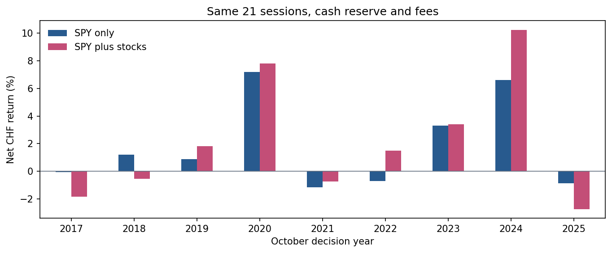
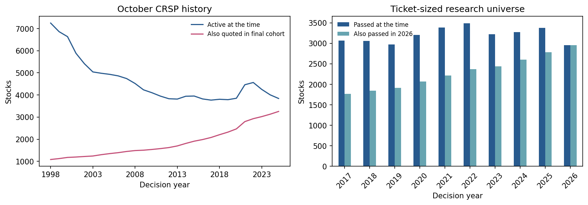

# What do individual US stocks add to RiskMatch?

The equity study reconciles the local CRSP history, tests a ticket-sized stock screen and compares owning SPY with owning SPY plus individual shares. The decision date is 30 October 2026. Research eligibility depends on the size of the intended investment. Live account permissions and verified settlement are separate requirements.

## 9.1 · Reconcile the sources and corporate actions

| Source | Coverage and role | Limit |
|---|---|---|
| Local CRSP daily CIZ-style export | 54,356,930 rows, 2 January 1998 to 31 December 2025. PERMNO, ticker, close, total return, bid, ask and shares outstanding. | The supplied daily export omits volume and a separate delisting-return field. |
| Local monthly CIZ export | 2,639,046 raw rows, January 1998 to December 2025. Includes identifiers with validity dates, incorporation, share and listing type, SIC industry, volume, total and ex-distribution returns, distributions and exit flags. | Multiple distributions can repeat a security-month. The preceding catalogue separates event rows and quarantines 13,520 conflicting security-months. |
| 2026 price bridge | All 3,824 members of the active December 2025 cohort reviewed. Registered overlap checks compare source prices, return distributions and split adjustments before the join. Secondary Nasdaq closes corroborate some initially incomplete paths. | Adjusted histories were retrieved later. The first-pass 3,129 complete histories and the 3,255 stocks with usable October model estimates answer different questions. |
| October listing snapshot | 6,982 records across Nasdaq, NYSE and NYSE American in an independently archived Nasdaq screener commit at 00:28 UTC on 30 October, before the US opening. | A screener is a source of candidate listings. Its country labels, ticker matches and publication time do not certify permanent identity or account access. The later November directory is a secondary check only. |

The private archive retains security-level discrepancies. The public summary contains field inventories, dates, missing-field counts by year and source hashes in the associated configuration and manifests. In 2025, daily compounding and monthly total returns agree within one basis point on all **46,320 complete, non-terminal security-months** covering 4,092 equities. The median absolute difference is 0.009 bp. Incomplete and terminal months require separate treatment. [Stock bridge and overlap tolerances](../actions-2026/README.md) · [Dated October listing archive](https://github.com/rreichel3/US-Stock-Symbols/tree/c05edd62db811dab2ca14ae1b7cbc1b4884fa154) · [Inputs and hashes](../../config/stocks-9.json)

Three controls exercise different parts of the chain.

- **Dividend.** On Apple's 10 February 2025 ex-date the previous close was USD 227.63, the close was USD 227.65 and the dividend was USD 0.25. The reconstructed total return is +0.11861%, matching CRSP to rounding. The distribution was payable on 13 February. Adding it to the total return a second time would overstate performance.
- **Ticker change.** The May and June 2022 month-end rows identify FB and META with the same PERMNO 13407. The historical line continues through the symbol change.
- **Cash acquisition.** Pandion's prior month-end quote was USD 60.20. Merck's USD 60.00 cash consideration implies −0.3322%, matching the March 2021 CRSP terminal total return. The last USD 60.05 quote gives a different answer. Completion on 1 April established the right to consideration. The investor-specific cash posting date remains unknown. [Merck completion announcement](https://www.merck.com/news/merck-completes-acquisition-of-pandion-therapeutics/)

## 9.2 · Build the dated screen and compare like with like

On each of ten October decision dates, start from US-incorporated common shares in the eligible listing venues, using that date's identities, close and risk-history gate (252 common returns in up to 504 sessions). For CHF 35,000, the mixed book sets aside CHF 3,500 cash and tests ten potential direct positions of **CHF 1,575** each. Require a positive verified turnover measure, an affordable whole share and an order no larger than **1% of estimated average daily dollar turnover**. No market-cap floor is imposed. Results are sensitive to ticket size. Historical dollar turnover uses that month's share volume times closing price divided by US sessions. October 2026 uses a 21-session average of observed daily dollar volume, with every price and volume present and at least 18 positive-volume sessions. Trade access remains unconfirmed for the entire research set.

Of the 3,824 October 2026 cohort records, 3,255 pass the earlier model-history checks. **2,959** also pass the section 9 ticket screen. Among the 296 additional exclusions, 291 exceed the turnover limit and five exceed the one-share budget. The notebook displays every exclusion category. The separate listing archive matches symbols for 2,945 of the 2,959. It also contains **1,879 US-labelled records outside the December cohort by symbol**. These can include other security types, changed symbols, different share classes and entrants. The ten-month IPO calendar has 289 deal records. A genuinely new 2026 listing can supply at most 209 sessions by the cutoff. A transfer or relisting could have earlier history and requires a verified link.

| CHF comparison rule | SPY only | SPY plus direct stocks |
|---|---:|---:|
| Equity ETF | 90% | 45% |
| Direct stocks | 0% | 45% across the ten highest-turnover passing stocks, equally weighted |
| CHF cash at zero interest | 10% | 10% |
| Entry and exit cost | 10 bp per notional traded | 10 bp per notional traded |
| Holding period | 21 exchange sessions | Same 21 exchange sessions |

Selection uses information dated through the decision close. Both books enter at the next close, hold fixed units and liquidate after 21 sessions. Fractions of a share reproduce weights in this research comparison after checking that at least one share fits the ticket. Dividends are included in total returns. Endpoints use the same USD/CHF conversions. A missing return or required quote invalidates the window. The nine completed windows show six higher CHF returns for the mixed book, with a mean paired difference of **+0.28 percentage points per window**. October 2026 has a recorded selection only. Its forward evaluation ends beyond the frozen market data. This is a set of short historical comparisons, with no continuous nine-year track record or outperformance claim.

Adding lines can increase issuer concentration. Using the later 20 November SPY holdings solely as a look-through check, the ten selected issuers account for 45.00% directly and another **15.61%** through SPY, or **60.61%** of total capital. Apple alone accounts for about 8.27%. This November disclosure was unavailable for October selection. [Dated holdings and issuer mapping](../04-catalogue/README.md) · [Portfolio and overlap results](results.json)

**Acceptance remains open for 9.2.** The dated cohort comparison runs, and the registers retain outstanding identities and settlements. The CRSP monthly rows identify 490 US common-share terminal records with cash already included in the return, 673 with stock or mixed consideration to trace, and 267 other terminal records requiring settlement evidence. These are row counts in the eligible-type monthly extract. Public quotes and a cash entitlement alone cannot establish when a broker credited an account. A dated 2026 security master with PERMNO, share class, listing changes and daily volume/total returns, plus distribution or successor terms for unresolved exits, would extend the verified universe. For an actual client, broker permissions and settlement records remain necessary. [Per-date counts and recorded outcomes](results.json)

## 9.3 · Attach only financial statements available on the decision date

We read the four SEC Financial Statement Data Set quarters from 2025 Q4 to 2026 Q3 through a pinned public Figurewell Parquet copy. The direct bulk download returned HTTP 403. The two Veritone filings below were checked against EDGAR itself. Each observation retains its CIK, accession, fiscal period, filing date and acceptance time. The transport has minute-resolution acceptance times for the bulk rows. The two manual controls use the original seconds. The availability rule is conservative: the first exchange session strictly after both the filing date and the US Eastern acceptance date. Filings received in October 2026 lie outside the downloaded quarters. [SEC dataset description](https://www.sec.gov/data-research/sec-markets-data/financial-statement-data-sets) · [Pinned transport](https://huggingface.co/datasets/CyberMax-tools/figurewell-sec-xbrl-financials/tree/d74dfdb8fdf4a326b64d8d0813163850f5d5a32a)

A matching ticker and normalized issuer name must identify one security in a valid CRSP interval. For 2026 we also require the verified year-end identity and a matching public traded bar at the filing date or previous US session. Conflicting CIK or PERMNO assignments are excluded. The join is a retrospective reconstruction. Comparable US GAAP assets and liabilities must refer to the same accession, unit and balance-sheet date. The most recent fiscal period is selected first, then its latest available filing. Distinct sources of missing coverage include name/class ambiguity, reporting outside the covered quarters and omitted balance-sheet tags. A missing balance sheet stays unknown. This ratio is descriptive and has zero weight in allocation.

The archive has **19,270** dated balance-sheet observations covering **2,510** securities. Of the October cohort, 2,506 have a linked balance sheet, including 2,070 of the 2,959 that pass the ticket screen. Veritone originally reported USD 200.221 million of assets for 30 September 2025. Its 10-Q was accepted after the close on Friday 7 November and first usable on Monday 10 November. The April 2026 amendment revised the same period to USD 198.605 million. The reconstructed November view still returns the original accession and its balance-sheet classification. [Original EDGAR filing](https://www.sec.gov/Archives/edgar/data/1615165/000161516525000027/veri-20250930.htm) · [Amended EDGAR filing](https://www.sec.gov/Archives/edgar/data/1615165/000162828026025211/veri-20250930.htm)

## 9.4 · Measure historical coverage and survivor selection

The public tables cover every October in the **1998–2025** monthly extract, and the ten 2017–2026 model decisions. They separate incorporation, security-type and exchange exclusions, then report industry group, active or stale quote, and research-screen reason. Historical SIC comes from each dated row. October 2026 uses the last verified December 2025 SIC and preserves missing codes. SIC records an administrative classification and can change without an equivalent change in a company's business.

In October 2017, **3,069** equities passed that date's ticket screen. Of those, **1,814** have a confirmed end-cohort quote and **1,766** also pass the October 2026 ticket screen. Starting the 2017 test with the final passing list would therefore discard **1,303** dated opportunities. The gap combines genuine exits, unverified 2026 coverage and changes in eligibility. It measures a selection effect. It cannot establish that all missing companies failed or quantify a return bias by itself.

The entry check finds Liberty Oilfield Services (LBRT) in the 2018 cohort after its January listing. The exit check follows the historical TCF identifier through July 2019. The sector-history check retains Honeywell's change from SIC 3714 (manufacturing) to 5099 (wholesale) between the October 2016 and October 2017 observations. [Year, sector and exclusion tables](results.json)

## Reproduce and inspect the records

Run `PYTHONPATH=src .venv/bin/python -m riskmatch_v2.stocks` from V2 with its section 4–8 research archives. The command verifies CRSP export hashes, retrieves pinned public files when absent and writes the detailed tables under `data/local/9/<archive>/`. The archive identifier is in [results.json](results.json). The public notebook runs from aggregate evidence alone.

| Private table | Lookup |
|---|---|
| `research_screen`, `positions`, `portfolios` | Permanent ID, decision date, exclusion, order participation, weights, outcome and fee treatment |
| `listing_register`, `ipo_review` | Dated venue and candidate identity, including records outside the cohort |
| `return_agreement`, `dated_cash_events`, `terminal_months` | Daily/monthly comparison, dated source cash distributions and unresolved terminal treatment |
| `filing_versions`, `current_fundamentals` | As-filed values by permanent ID and accession, or explicit missing coverage |
| `sector_history`, `sector_reasons` | Historical classification and exclusions by date and sector |

[Research notebook](../../RiskMatch_V2.ipynb) · [Checklist and acceptance criteria](../../CHECKLIST.md)
