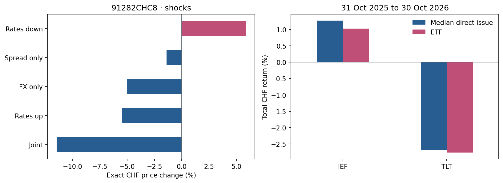
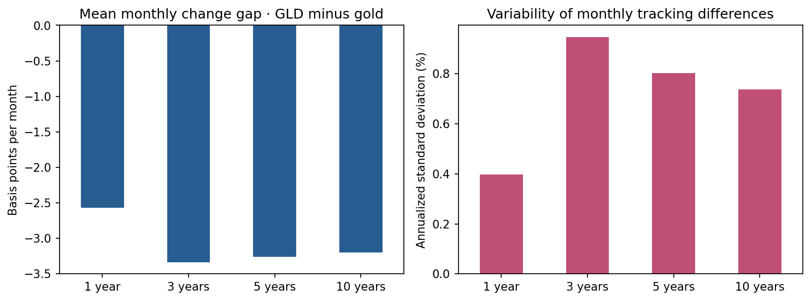

# US Treasuries and gold in the CHF portfolio

At the **30 October 2026** research cutoff, 64 of the 65 selected US Treasury issues have an observed closing mark and a reproducible valuation. The remaining note, 91282CRV5, was issued on 2 November. Of the 64 valued issues, 54 also pass the earlier allocation model's history requirements. The customer has zero verified executable secondary-market bond orders. [All 65 issue sheets](issues.json) · [Results and scenarios](results.json)

## 10.1 · What is known about each issue?

The 17 notes and 48 bonds are USD-denominated nominal Treasuries identified in the IEF and TLT holdings study. These holdings were disclosed after the cutoff and identify the research cohort retrospectively. For every CUSIP the register gives announcement, issue and maturity dates, coupon, original auction lot, historical mark count, source fund and eligibility. For measured issues it also gives clean and full price, accrued interest, remaining coupons and rate risk. Future coupon cash dates assume the current Federal Reserve holiday convention. Government data on buybacks add dated market activity. A secondary dealer's executable size, the client's permissions, fees and trade settlement terms remain unknown. [Treasury auction data](https://fiscaldata.treasury.gov/datasets/treasury-securities-auctions-data/) · [FedInvest price archive](https://www.treasurydirect.gov/GA-FI/FedInvest/selectSecurityPriceDate)

The archive contains 75,822 daily issue marks. FedInvest's two programme prices differ by a median USD 0.03125 per USD 100 face across the 64 marked issues on the cutoff. An account-specific dealer spread can differ. Auction lots also vary with date and venue. The original 2006 notice for 912810FT0 specifies a USD 1,000 minimum and increment, filling a missing field in the structured data. The June 2023 reopening below specifies USD 100. Neither lot establishes a customer's secondary-market minimum. [Original 2006 auction notice](https://www.treasurydirect.gov/instit/annceresult/press/preanre/2006/ofg020106.pdf) · [TreasuryDirect auction mechanics](https://www.treasurydirect.gov/indiv/help/treasurydirect-help/faq/)

## 10.2 · From contractual cash flows to value and rate risk

For a regular coupon period, accrued interest equals the semiannual coupon multiplied by elapsed calendar days divided by actual days in that period. Clean price plus accrued interest gives the full price. The yield calculation discounts the fractional period to the next coupon using simple interest, then discounts subsequent half-years with semiannual compounding. There is one principal payment at maturity. If a contractual date is a weekend or a Federal Reserve holiday, payment moves to the next business day with no extra interest. [Treasury auction regulations, §356.30 and Appendix B](https://www.govinfo.gov/content/pkg/CFR-2025-title31-vol2/xhtml/CFR-2025-title31-vol2-part356.html)

**Independent price check.** The June 2023 reopening of note 91282CHC8 settled on 15 June. Its coupon is USD 1.6875 per half-year per USD 100 face. From 15 May to settlement, 31 of the period's 184 days had elapsed. Accrued interest was therefore USD 0.284307 per USD 100. Discounting the 20 remaining coupons and principal at the auction yield of 3.791% produces a full price of 96.867946. Subtracting accrued interest gives 96.583639, matching the published auction price to six decimals.

At the October 2026 cutoff the same note has a clean price of 92.03125, a full price of 93.57201 and a yield to maturity of 4.8082%. Modified duration is 5.6616 years. Its DV01 is approximately USD 0.53 for USD 1,000 face, the estimated loss for a one-basis-point yield increase. The table reports instantaneous full-price changes with fixed cash flows.

| Shock | Exact CHF return |
|---|---:|
| Yield +100 bp, FX fixed | −5.48% |
| Yield −100 bp, FX fixed | +5.85% |
| Hypothetical additional yield spread +25 bp | −1.40% |
| USD loses 5% against CHF, yield fixed | −5.00% |
| Yield +100 bp, spread +25 bp and USD loses 5% | −11.45% |

The additional spread is an assumed pricing shock. A nominal Treasury quote cannot identify a separate credit component or a default probability. The joint result uses exact multiplicative currency conversion. Each issue's full repricing is compared to its duration-plus-convexity approximation. In 47 issues at least one scenario exceeds the five-basis-point tolerance on price. All reported shock results use full repricing. Section 8's two-tenor curve stress answers a separate question about curve shape. [Every issue's risk metrics](issues.json) · [Section 8 curve study](../08-chocs/README.md)

**Direct issues versus Treasury ETFs.** Between the 31 October 2025 and 30 October 2026 closes, 54 issues have complete paths across the same 249 observed Treasury dates. Direct returns reinvest coupons at observed marks. ETF total returns use adjusted closes with fund expenses embedded. Both use the same CHF conversion at the endpoints. The equal-issue median describes the measured issues only. Investor taxes, dealer fees and order spreads are omitted.

| Cohort | Complete paths / selected issues | Median direct total return in CHF | ETF total return in CHF |
|---|---:|---:|---:|
| IEF holdings | 11 / 18 | +1.27% | +1.03% |
| TLT holdings | 43 / 47 | −2.69% | −2.76% |

## 10.3 · Gold held through GLD

GLD is a US-listed trust backed by physical gold. It has no futures roll and sells small quantities of gold to cover expenses. The sponsor quotes an annual expense ratio of **0.40%**. The amount of gold backing a share declined by 8.31% between the study's first and last available issuer observations. GLD trades in USD, so a CHF investor also experiences currency changes. The sponsor's archive is used privately to cross-check daily closes, reported ounces per share and NAV. Prices struck at differing times can produce a gap between the NY closing price and the reported NAV. [Sponsor, costs and mechanism](https://www.spdrgoldshares.com/usa/gld/)

The independent gold comparison uses World Bank monthly average USD prices and monthly averages of GLD adjusted closes. It has **262 common months and 261 consecutive changes**, from January 2005 through October 2026. From June 2025 the World Bank describes its series as a spot average. Previously it used London afternoon fixes. We also measure the two periods separately, excluding the transition month. The World Bank published the October observation on 3 November. Its use here is retrospective. Monthly averages can be compared on a common period but cannot be filled at a single trade. [World Bank Pink Sheet and source documentation](https://thedocs.worldbank.org/en/doc/74e8be41ceb20fa0da750cda2f6b9e4e-0050012026/world-bank-commodities-price-data-the-pink-sheet)

Over the last ten years, monthly changes in GLD and gold have correlation **0.9982**. The annualized standard deviation of their monthly return differences is **0.74%**. Over the latest year their monthly-average price changes were +0.82% and +1.16%. For someone actually holding GLD between the two month-end closes, the total return was **−3.35% in USD and −0.91% in CHF**. The difference comes from the valuation dates and currency. Trust costs are already reflected in GLD's history. WTI remains an oil factor in USD per barrel. The section 8 estimate for GLD in a +USD 10 oil shock has a 95% coefficient interval crossing zero. [Gold and WTI results](results.json) · [Oil shock study](../08-chocs/README.md)

## 10.4 · From a published mark to a funded purchase

Treasury buyback results from January 2024 through October 2026 contain **230 positive issue-operation awards covering 45 selected issues**. Each record identifies the issue, acceptance date, settlement date, aggregate par accepted and weighted purchase price. The median absolute gap between the weighted buyback price and the same day's FedInvest close is USD 0.04725 per USD 100. For example, on 27 October 2026 Treasury accepted USD 1.014 billion par of 912810SX7 at 59.011, settling on the 28th. Aggregate awards reflect a particular operation and cannot establish a retail customer's fill size. Issues without an award in this source can still have traded elsewhere. [Official Treasury buyback records](https://fiscaldata.treasury.gov/datasets/treasury-securities-buybacks/)

| Test | Dated evidence and outcome |
|---|---|
| Stale quote | On the 12 October 2026 bond holiday, the latest mark for 91282CHC8 was 9 October. The order check rejects that price. |
| Funded historical auction | Illustrative eligible USD account, USD 1,000 face at the actual June 2023 reopening. The issue-date debit is USD 968.68. USD 31.32 of the assumed USD 1,000 balance remains. |
| Coupon | The 15 November payment is USD 16.875 before cent rounding, or USD 16.88 in this cash illustration. The balance becomes USD 48.20. Its historical total return reconciles the change in dirty price with the coupon exactly once. |
| Lot or cash mismatch | USD 1,050 violates the USD 100 increment. Cash available on 16 June cannot fund settlement on 15 June. Both tests reject the order. |
| Redemption control | None of the selected 65 had matured by the cutoff. A separate historical note, 91282CHY0, matured on 15 September 2026. Its last clean mark was 100. USD 1,000 principal and a final USD 23.125 coupon produce USD 1,023.13 under the illustration's cent-rounding rule. The security leaves the holdings ledger at redemption. |
| Research mandate | The client has no verified account access or executable secondary size. A duration mandate can be compared with IEF or TLT. A fixed-date USD principal requirement needs a maturity match. A near-term CHF bill can use already settled CHF if available. Each alternative retains its own eligibility checks. |

The auction example assumes timely submission by an eligible noncompetitive bidder, a funded USD account, no brokerage fee, and nearest-cent, half-up rounding for the illustrative cash ledger. Treasury reported USD 18.3146 million of noncompetitive awards in that reopening. The cash exercises verify a contractual entitlement and funding feasibility. Customer fills and bank postings require account-specific records. [Auction settlement rules](https://www.treasurydirect.gov/indiv/help/treasurydirect-help/faq/) · [Results and access tests](results.json)

## Reproduce and inspect

From V2 run `PYTHONPATH=src .venv/bin/python -m riskmatch_v2.treasury_gold` with the frozen market archives and catalogue dependencies. The study verifies source fingerprints, including canonical date-bounded gold observations for workbooks whose publication metadata may change. Source workbooks remain local. The four numbered notebook cells run from the published issue sheets and aggregate results with no private market files. In 10.1, change the CUSIP to inspect any selected issue.

The versioned local archive contains the coupon and principal schedules, five shocks per measured issue, historical buyback awards, matched ETF paths and common gold months. The archive ID is in [results.json](results.json). [Issue register](issues.json) · [Assumptions and source hashes](../../config/treasury-gold-10.json) · [Research notebook](../../RiskMatch_V2.ipynb)
