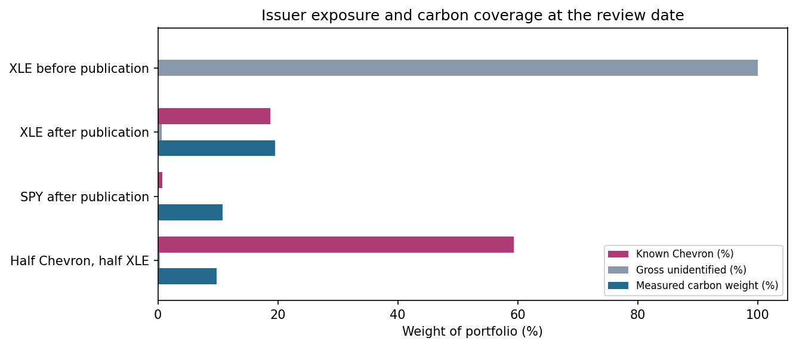
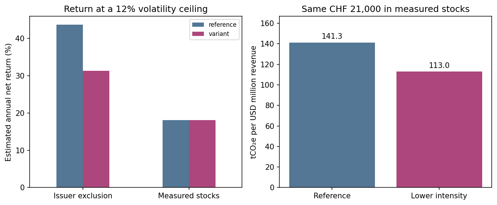

# Environmental preferences

The two client requests produce different decisions. A named issuer can be excluded wherever a holding can be identified. A request for lower emissions needs a defined measure and a portfolio with comparable coverage. The study uses 3,322 instruments in the frozen 30 October 2026 CHF market model. The environmental review uses ETF holdings dated 20 November, available by 23 November 2026 at 14:00 UTC. This is a retrospective comparison using two explicit dates.

## 11.1 · Identify exposure and measure coverage

**Named issuer.** The example mandate prohibits securities of Chevron Corporation, directly or through funds. We confirm the issuer in the October inventory, verify its security identifier and aggregate each fund's latest published positions by issuing entity. This scope covers the named issuer. A group-wide prohibition covering subsidiaries would require a dated corporate ownership map. A direct stock with an unconfirmed identifier remains unknown. Fund positions without an issuer and any imbalance against 100% contribute to the gross unknown weight using absolute values. Signed weights are retained separately for reconciliation.

| Holding and information available | Known Chevron weight | Gross unidentified weight | Weight with emissions measure | Mandatory decision |
|---|---:|---:|---:|---|
| Chevron directly | 100% | 0% | 0% | Exclude |
| XLE on 30 October | Unknown | 100% | 0% | Suspend |
| XLE after publication | 18.75% | 0.65% | 19.55% | Exclude |
| SPY after publication | 0.69% | 0.19% | 10.82% | Exclude |
| Half Chevron, half XLE | 59.37% | 0.32% | 9.77% | Exclude |
| GLD without a constituent file | Unknown | 100% | 0% | Suspend |
| Direct US Treasury | 0% | 0% | Outside scope | Verified |

Knowing exactly who issued a security can be enough to enforce the named exclusion even when its emissions are unknown. For GLD this table records the coverage of the issuer file used for the exclusion test. Section 10 separately documents its physical gold exposure. [Treasury and gold study](../10-treasuries-gold/README.md)

**Client instructions.** P07 and P08 record the scope, priority, strength and action on missing data. The study starts from a confirmed issuer identifier or a quantified preference. A known breach excludes the mandatory option. Where the identity remains unknown, the requested action can suspend the option, request clarification, or allow a flagged comparison for information only. A flagged mandatory option remains ineligible. A soft breach stays visible for comparison. Priority does not override a mandatory exclusion. [Questionnaire cards](../02-questionnaire/CARDS.md)

**Intensity.** For each matched issuer, multiply each US facility's 2023 reported direct emissions by the parent's reported ownership share. Sum these tonnes and divide by 2023 consolidated revenue in millions of USD. The numerator comes exclusively from the EPA’s *Direct Point Emitters* sheet, in metric tonnes of CO₂ equivalent, as reported by 16 August 2024. The study uses the October 2024 publication. Of 6,470 facilities, 6,379 have ownership schedules that reconcile to 100% within 0.01 percentage point. The other 91 drop out before matching. Separate program sheets covering distributed activities, foreign operations, purchased energy and value-chain emissions are outside this measure. [EPA data and 2023 downloads](https://www.epa.gov/ghgreporting/data-sets) · [GHGRP reporting scope](https://www.epa.gov/ghgreporting/ghgrp-reported-data)

The denominator uses a positive four-quarter US-GAAP revenue fact ending on 31 December 2023. The frozen section 9 SEC extract supplies the latest eligible 10-K or amendment available by the October model cutoff. We retain the accession, acceptance time and revenue tag. We require the verified stock-to-filer link, confirmed issue identifier and unambiguous normalized parent name. These requirements yield **54 issuers and 55 modelled share lines**. Differences in facility reporting coverage, corporate reorganizations and restated sales limit comparisons between companies. A missing match carries no emissions estimate. [54 issuer calculations and filing identifiers](issuers.json) · [SEC financial statement datasets](https://www.sec.gov/data-research/sec-markets-data/financial-statement-data-sets) · [Identity and filing audit](../09-stocks/README.md)

For example, the 11 matched 3M facilities account for 1,007,144 ownership-weighted tonnes. Dividing by USD 24,610 million of reported revenue gives **40.92 tCO₂e per USD million**. Portfolio intensity is the weighted sum of issuer intensities divided by the weight with measurements. Coverage is measured as a fraction of the full CHF capital. CHF cash, fees and direct sovereign obligations are outside corporate intensity. At zero covered weight, the portfolio intensity is unavailable.



## 11.2 · Compare portfolios under a confirmed mandate

We maximize annual modelled net return subject to the same 12% annual volatility ceiling within each pair. The investable pocket starts with CHF 35,000 in cash. Section 5's one-year horizon, instrument limits and one-way 10 bp trading cost apply. Returns and volatility below are model estimates. Fees are entry costs in CHF. The two studies have different research mandates and each has its own reference.

| Mandate and option | Invested | Estimated annual net return | Annual volatility | Entry fee | Capital with measured intensity | Intensity on measured holdings |
|---|---:|---:|---:|---:|---:|---:|
| Full universe · reference | 90% | 43.71% | 12.00% | CHF 31.50 | 7.62% | 30.11 |
| Full universe · mandatory exclusion | 90% | 31.27% | 12.00% | CHF 31.50 | 12.70% | 54.80 |
| Measured stocks · reference | 60% | 18.09% | 12.00% | CHF 21.00 | 60.00% | 141.28 |
| Measured stocks · flexible preference | 60% | 18.04% | 12.00% | CHF 21.00 | 60.00% | 113.03 |

**Mandatory exclusion.** Of the 3,322 modelled instruments, 1,461 pass the named exclusion and full issuer-identification rule. The neutral optimum already has zero *identified* Chevron exposure, but 62.23% of capital has unresolved issuer exposure. The screened optimum has zero prohibited and zero unresolved exposure. Its estimated net return falls by **12.43 percentage points**, with the same risk and fee to displayed precision. The change reflects the strict treatment of unknown identities as well as the prohibition. The measured carbon subset changes substantially, so these two portfolios receive no relative carbon ranking. The unusually high modelled returns reflect optimization over historical estimates and have no prospective validation here.

**Flexible preference.** To isolate the effect, both options invest exactly CHF 21,000 across the same eligible set of 55 measured share lines. The remaining capital covers cash and entry fees. The illustrative preference sets a ceiling 20% below the reference's conditional intensity. Intensity falls from 141.28 to 113.03 at a cost of **0.059 percentage point of estimated annual net return**, with equal fees and volatility to displayed precision. The two portfolios hold 12 and 10 lines respectively. This result applies to matched US point-source emissions per unit of revenue. It cannot establish a 20% fall in a client's global financed emissions. The engine reports ties and unavailable or unequal coverage without awarding an environmental rank.



The Streamlit Options page displays both archived pairs under **Environmental mandate study**. Select the mandate to see the corresponding coverage, risk, fee and estimate.

## Reproduction

Run from the V2 root after reproducing the frozen section 4, 6 and 9 archives. The build downloads the two EPA files if missing, verifies their SHA-256 digests and checks the SEC facts against the section 9 source lock. The public notebook reads the results and issuer calculations directly and regenerates both figures. Local Parquet files under `data/local/11` retain the instrument coefficients, four portfolios and linked issuer records.

```sh
python -m pip install -e '.[catalogue,faisabilite,environment,notebook]'
PYTHONPATH=src python -m riskmatch_v2.environment.study
```

[Input hashes, controls and paired results](results.json) · [Source processing](../../src/riskmatch_v2/environment/measurement.py) · [Allocation and mandate checks](../../src/riskmatch_v2/environment/study.py) · [Notebook](../../RiskMatch_V2.ipynb)
