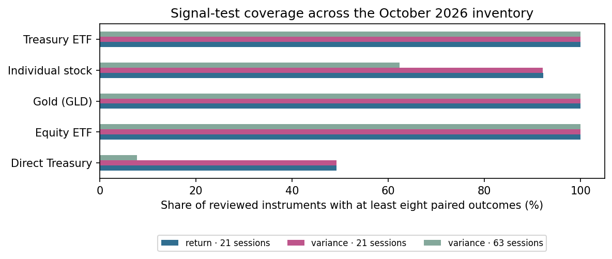
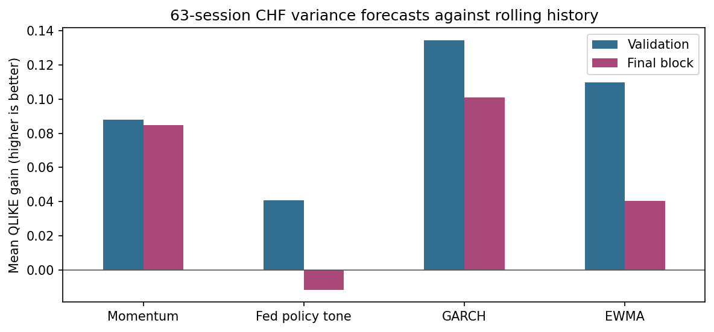
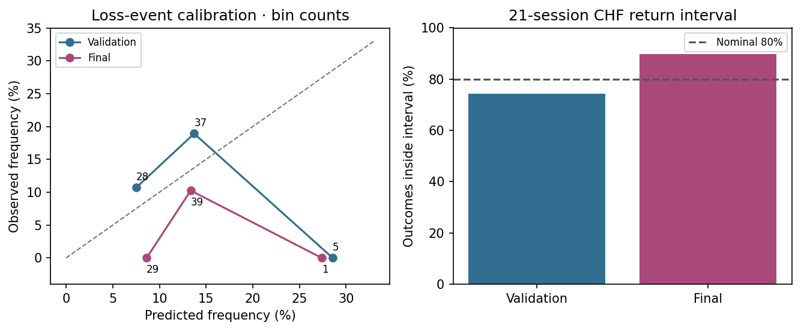

# Forecasts, signals and portfolio decisions

**Allocation decision on the evidence reviewed on 23 November 2026.** All 52 model–target–horizon combinations retain zero recommendation weight. There is one particularly informative result. At 63 sessions, momentum improves the variance forecast on held-out data, but sizing a portfolio with it breaches the client's 12% risk ceiling in **3 of 22** periods. The historical reference breaches it in **2 of 22**. The recommendation keeps its reference. The same panel is available under **Options → Forecast evidence**.

## 12.1 · Scope and protocol

The protocol was committed before running this study's scores. Market observations end on 30 October 2026. The common calendar contains 5,441 SPY closes with a CHF exchange rate from January 2005. Each decision uses predictors from the preceding common session or earlier. The position is entered at the decision close and the target starts with the following return. Origins advance by the whole horizon. Training expands using labels that have already matured. A target ending at the decision or crossing the validation/final boundary stays out of the fit. Validation starts in January 2015. The reserved block starts in January 2021, with model parameters refitted only as labels mature. Earlier V2 research had already examined some of these market years. This is a chronological retrospective test, and it has no prospective trading record. [Frozen protocol](../../config/forecasts-12.json) · [Protocol commit](https://github.com/NvarMaley/RiskMatch-V2/commit/00f4a05)

| Target | Reference | Candidate evidence | Final observations |
|---|---|---|---:|
| 21-session CHF SPY variance | Previous 63 daily squared returns | QLIKE, squared variance error, realized volatility budget breaches | 69 |
| 63-session CHF SPY variance | Same reference | Same metrics on disjoint quarterly-length periods | 22 |
| 21-session CHF SPY excess return | Half the expanding mean of matured block returns | Squared error and terminal CHF after costs | 69 |
| Loss of at least 5% at the 21-session endpoint | Smoothed expanding event frequency | Brier loss, calibration bins and event count | 69 |
| Central 80% return interval | Expanding historical 10th and 90th percentiles | Frequency inside interval, width and uncertainty | 69 |

The signal-model comparison is for **SPY in CHF**. It cannot establish a rule for individual stocks, Treasury issues, gold or a customized portfolio. The earlier security-by-security study remains part of V2. It has at least eight paired variance forecasts for **3,860 instruments at 21 sessions and 3,639 at 63**. The five current portfolio notices use their own holdings. [Instrument-level results](../econometrie/README.md) · [Forecasts at 21 sessions](variance-21-predictions.csv) · [Forecasts at 63 sessions](variance-63-predictions.csv) · [Return and calibration observations](return-21-predictions.csv)

## 12.2 · Sources and timing

| Family | Signal and scale | Availability rule and limitation |
|---|---|---|
| Macro | US 10-year minus 2-year yield in percentage points | Two business days of embargo, followed by the prior-session cutoff. No rate interpolation. Daily Treasury source history is limited in the local archive. |
| Macro | US unemployment rate in percent | Select the most recent observation in the latest available ALFRED vintage. The archive contains 262 editions and 156 observation dates with revisions. |
| Market | Cboe VIX closing index level | Previous close. VIX describes implied US equity volatility in USD. Its relationship to CHF variance is tested empirically. |
| Quantitative | Log 21-session mean squared CHF return, delayed momentum, relative dollar volume | Momentum compares levels 126 and 21 sessions back. Liquidity compares five- and 63-session mean dollar volume. All use completed sessions. |
| Geopolitical | Caldara–Iacoviello monthly GPR index | 60 dated editions in the archive. Assign each completed edition a conservative month-end availability bound. The October 2026 edition falls after the market cutoff. There are no usable GPR editions in validation. |
| Sentiment | Hawkish minus dovish dictionary hits per 100 words | 176 distinct official Fed statements. Apply a conservative 23:59 New York release-day bound and the common prior-session lag. The score measures policy language. Consumer mood, earnings tone and social-media sentiment are separate concepts. |

Each Fed item has a source URL, publication day, conservative availability time, word count and SHA-256 of the extracted text. Board-authored material is generally public domain under the Board's stated terms. Raw pages and extracted text remain local. The published manifest contains derived scores and source references. Market data stay in the local V2 archive. GPR editions are credited to Dario Caldara and Matteo Iacoviello under the authors' CC BY terms. Only 78 distinct statements predate 2015, below the frozen 300-document requirement for fitting a richer language model. No newswire or social-media corpus with established publication times and usage rights was used. The duplicate, revision, after-close and daylight-saving controls are executable. The historical adjusted price file was collected after the cutoff, so original daily vendor vintages remain unverified. [Fed calendar and archives](https://www.federalreserve.gov/monetarypolicy/fomccalendars.htm) · [Board reuse terms](https://www.federalreserve.gov/disclaimer.htm) · [Release manifest](fomc-releases.json) · [ALFRED](https://alfred.stlouisfed.org/) · [Cboe VIX history](https://www.cboe.com/tradable_products/vix/vix_historical_data) · [GPR methodology, vintage archive and license](https://www.matteoiacoviello.com/gpr.htm)

## 12.3 · Models and Black–Litterman

Variance candidates include EWMA with decay 0.94, zero-mean GARCH(1,1) fitted to up to 756 prior CHF returns and fixed-alpha Ridge. Each of the eight signals is fitted alone and as an addition to the reference. The scaler is fitted only on training rows. Variance Ridge operates in log units. Annualization uses 252 sessions. At 21 sessions both GARCH and EWMA improve mean final QLIKE, with insufficient evidence under the admission rules. Return Ridge is evaluated on compounded block returns above the project's zero-interest CHF cash assumption. [Model code](../../src/riskmatch_v2/forecast/models.py) · [All paired scores and funded outcomes](experiments.json)

Black–Litterman was **run as a one-view diagnostic**. The strongest validation return increment by mean squared error was the VIX-based Ridge view. The single absolute SPY view uses P = [1], a half-mean prior, uncertainty of the estimated prior mean and a view-error variance frozen from validation. As view uncertainty tends to infinity the posterior reproduces the prior. Both final funded rules end at CHF 54,034 after costs. Their estimated returns differ slightly, but their funded decisions coincide. The posterior is inactive. The full allocation universe has no corresponding verified vector of views. [Posterior and cost replay](results.json)

### Transfer check on every inventory instrument

After the SPY study, we froze a separate descriptive audit for the complete October inventory. Each of the 3,902 names receives a row for all eight signal increments and each of the three target/horizon pairs, giving **93,648 attempted combinations**. Each fit uses the individual instrument's CHF return and its own matured targets. The common macro, market and policy series retain their dates. Realized risk and momentum are rebuilt per instrument. The ETF library supplies dollar volume, while missing stock and direct Treasury liquidity observations remain explicitly unscored. The standardized one-feature Ridge calculation was checked against the scikit-learn implementation.

| At least eight matched final outcomes for one or more signals | Measured | Reviewed |
|---|---:|---:|
| 21-session return | 3,572 | 3,902 |
| 21-session variance | 3,568 | 3,902 |
| 63-session variance | 2,402 | 3,902 |

For 21-session variance, this includes 3,523 individual stocks, 32 direct Treasury issues and all 13 listed funds, including GLD. Short histories and incomplete observations limit the longer horizon. The source panel begins in October 2014 and the inventory is selected in October 2026. These counts measure historical testability in the selected cohort. A positive mean gain in one of several specifications carries no allocation weight. This extension has no independent funded validation across the library. [Coverage policy](../../config/forecasts-12-coverage.json) · [Counts by class, signal and target](cross-asset.json)



## 12.4 · Overheating and detection delay

We test monthly USD closing prices on SPY, GLD and IEF. The simple alert is a six-month gain above 20%. The recursive test uses log prices, rolling 60-month windows, at least 24 price observations and right-tailed ADF regressions with an intercept and no augmentation lags. We archive fixed-start SADF, full-window GSADF and end-date BSADF. Only the endpoint statistic dates the alert. Critical values come from 999 simulated random walks, taking the supremum over candidate windows and adjusting across the three funds. An independent set of 1,500 null paths exceeds the adjusted threshold in 2.0% of paths per series. The null describes an iid random walk. It does not cover every financial price process or control every alert over the full calendar.

A hit is a subsequent month-end loss of at least 10% from that alert's close within six months. Consecutive alerts can describe the same episode. On the final block there are 64 mature alert dates per fund. After adjustment, GLD has six alert months from September 2025 through February 2026. Two precede the event, with delays of five months and one month. Four are false alerts under the stated definition. SPY and IEF have zero adjusted alerts despite subsequent losses on some dates. This indicator stays descriptive. [Dated statistics and outcomes](overheating-months.json)

## 12.5 · Statistical and funded gates

We pair forecasts on the same dates, require at least 80% coverage, a positive 95% moving-block bootstrap lower bound and a gain in at least two of three chronological segments. The economic comparison starts with CHF 35,000, holds at most 60% SPY, uses the same 12% annual volatility ceiling and charges 10 basis points on actual SPY trades and liquidation. We track cash, risky holdings, drift and fees. The risk rule must reduce both the frequency and average positive size of breaches. The return rule must improve terminal wealth after fees. The research gates must hold in validation and on the reserved block. Limited samples and testing many specifications warrant caution even for individually positive intervals.

The 63-session momentum forecast has a final QLIKE gain of **0.0849**, with a paired 95% interval of **0.0256 to 0.1900**. Average positive excess volatility increases from 0.55 to 0.61 percentage point across all periods, and breaches increase from two to three. The policy-tone variance signal passes validation at this horizon but its final QLIKE gain turns negative. GPR lacks sufficient early vintages to enter the comparison on equal terms. [Evaluation code](../../src/riskmatch_v2/forecast/evaluation.py) · [Results and reasons for every candidate](experiments.json)



## 12.6 · Signal weights and disagreement

Each register row identifies family, target, horizon, model version, measurement date, value, predicted direction relative to the reference, evidence and effective weight. The validation correlation between the 63-session momentum and tone forecasts is **0.985**, above the 0.85 redundancy threshold. Retaining momentum leaves one forecast, so the equal and validation-weighted combinations coincide with that single forecast. Its final funded test fails. The equal mix before redundancy filtering also underperforms momentum on final QLIKE. At the other target/horizon pairs no eligible validation set remains. All incremental contributions to a client allocation are zero. Two opposed approved signals and a missing component are exercised separately as fixtures. [Versioned register](registry.json) · [Combination comparisons](results.json)

## 12.7 · From a risk notice to an action

All five October portfolios have separate 21- and 63-session notices. The historical estimator uses 63 days of past squared CHF returns on the portfolio's own fixed weights, including cash. The horizon estimate scales the daily reference by the square root of the horizon, assuming constant variance and no serial covariance. This is a risk scale, not a loss boundary. Rate shocks use the section 8 ten-year +50 bp and slope +25 bp components, with direct bond repricing. Tables also retain oil +USD 10, USD/CHF +5% and the joint shock with their coverage.

For the **Return** portfolio the reference risk scale is **4.67% over 21 sessions** and **8.08% over 63**. The joint conditional shock is about **−CHF 652** on CHF 35,000. The rate component alone is about **−CHF 698**. A concerned client can compare a hedge against the same shock, fee and funding schedule. A market alert alone does not trigger a trade. In the fixed-weight backcast, the Return portfolio's 21-session annualized volatility rises from 14.67% to 17.99% between adjacent windows ending in October. The section 7 stress confirms that client A pays the March 2027 bill from the CHF 15,000 reserve even under the immediate loss scenario. The longer-term goal still has an estimated CHF 23,693 deterministic shortfall in that scenario. Client B's corresponding gap is CHF 52,925. A change in the long-term goal requires a funding review. [Portfolio notices and stress amounts](results.json) · [Funding scenarios](../07-funding/README.md)

## 12.8 · Version and scope controls

The portfolio scoring engine reads the versioned registry. An annual return score requires approval for the precise portfolio, target, horizon, date, version and score. Unregistered values, an expired version, a withdrawal, an extreme rejected forecast or a 21-session SPY result cannot change the annual portfolio score. Tests replay the older approved version at its own date. Portfolio-specific notices fall back to their own historical variance. The Options page shows each tested family separately, including its reason for exclusion. [Admission logic](../../src/riskmatch_v2/forecast/registry.py) · [Scoring engine](../../src/riskmatch_v2/options/scoring.py)

## 12.9 · Probabilities and intervals

There are **four endpoint losses of at least 5% in 69 final 21-session blocks**. The risk-based logistic model's final Brier score is 0.0569 versus 0.0597 for the historical event frequency. The paired uncertainty interval includes zero and four events fall below the ten-event minimum. The central 80% return interval contains 74.3% of validation outcomes and 89.9% of final outcomes. Both miss the predeclared coverage tolerance in at least one direction. The client receives neither an event probability nor a calibrated return interval. The probability bins and interval diagnostics remain available for research. [Calibration results and sparse-event/regime-shift controls](results.json)



## Reproduction

From the V2 root, install the pinned catalogue, feasibility, forecast and notebook dependencies. Keep the frozen section 4, 6 and 8 archives and the section 7 cases available for the full rebuild. Public files suffice to re-execute the numbered notebook cells, reproduce the charts and inspect each dated prediction. Rebuilding from sources checks normalized input hashes. Live upstream pages can change, so keep the cached originals for exact replay.

```sh
python -m pip install -e '.[catalogue,faisabilite,forecast,notebook]'
PYTHONPATH=src python -m riskmatch_v2.forecast.study
PYTHONPATH=src python -m riskmatch_v2.forecast.coverage
PYTHONPATH=src python -m unittest discover -s tests
```

[Input fingerprints](sources.json) · [Research notebook](../../RiskMatch_V2.ipynb) · [Checklist](../../CHECKLIST.md)
