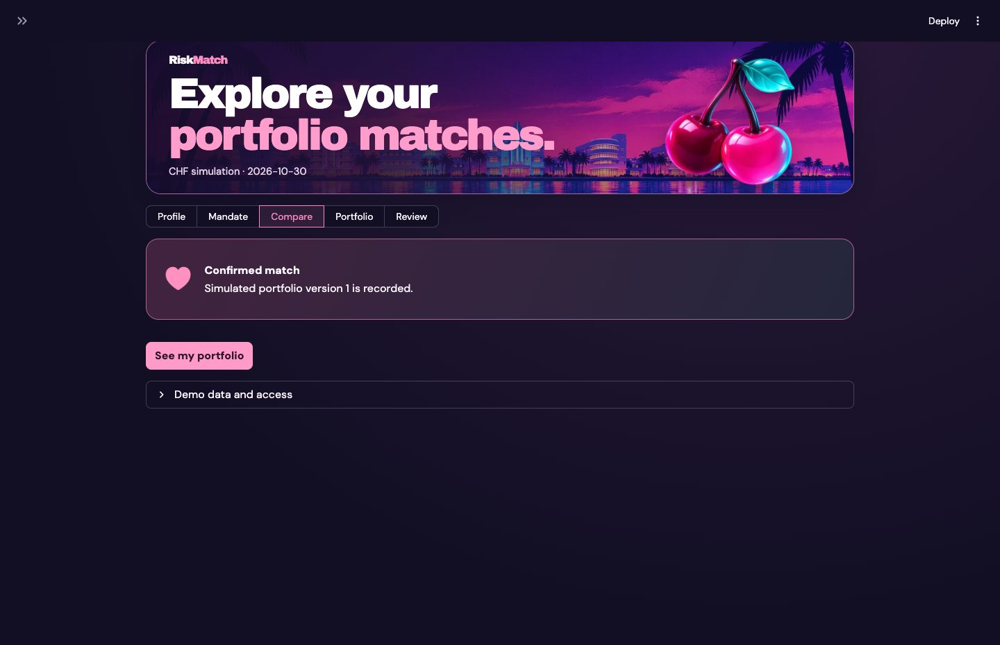

# Portfolio matching and monitoring

A fictional client can complete the 41-card interview, confirm an investment mandate, compare feasible portfolios, choose percentages and track the resulting holdings in CHF. A proposed change shows the consequences of keeping or switching before the client decides. [Research notebook](../../RiskMatch_V2.ipynb)

## Run the application

From the repository root, use Python 3.12 and the local virtual environment.

```sh
python -m pip install -e '.[questionnaire,catalogue,faisabilite]'
python -m streamlit run app/questionnaire.py --server.address 127.0.0.1
```

Open the URL printed by Streamlit. Select **Try a fictional profile** or answer the active cards individually. For the illustrated case, confirm the answers, choose **Volatility cap**, enter **12%** on the investment sleeve and answer both capacity and comfort questions. On **Compare**, select **Compose an allocation**, choose **Return** and **Diversification**, and set their shares to **60%** and **40%**. Inspect the fee and the rounded holdings before confirming. From **Portfolio**, advance the close, record a deposit and open **Request a review**. Selecting an alternative opens a new draft.

## What the model can compare

The historical research universe contains 3,322 eligible model instruments. The application uses five dated section 6 source portfolios. Their union holds 329 distinct instruments, including 326 individual stocks and SPY, IEF and GLD. Direct Treasuries received zero weight in these source portfolios. The engine combines source weights, adjusts the risky share to the mandate, rounds to whole tradable units, retains residual CHF cash and checks the resulting risk, fees, loss capacity and funding. A minimum-risk mandate can hold CHF cash. The optimizer evaluates admissible combinations on a ten-percentage-point grid under the selected objective. The Sharpe criterion uses the model net return divided by annual volatility with a zero CHF risk-free rate in this simulation. Manual shares use one-percentage-point increments. A hard constraint that cannot be verified suspends a match. A band with no matching option can remain unanswered.

The return, stress, diversification and cost inputs belong to the dated model. The four available comparison components have 75 points of nominal weight and are rescaled to 100 for the displayed model score. Historical and forecast components lack a validated score for the newly rounded positions. The score is a comparison aid. All section 12 signals retain zero decision weight. Optional questionnaire preferences remain visible in the portrait. A verified new environmental mandate or a new institution-wide security screen requires the upstream research workflow. [Source allocations](../univers-complet/README.md) · [Signal register](../12-forecasts/registry.json) · [Derived model](market.json)

## The 60/40 decision

Both examples begin with CHF 35,000. They use the same source weights and risk parameters. The local archive supplies the observed first-close price and exchange-rate inputs on 30 October 2026. A public checkout uses deterministic fictitious prices for this first close. All subsequent marks, dated 2–5 November, are simulated. Prices and FX carry timestamps. Fractional source shares can produce different whole-unit portfolios on the two tapes. A 60/40 strategy split therefore has a different meaning from a 60/40 stock/bond split.

| Research replay | Archived first close | Portable fill simulation |
|---|---:|---:|
| Distinct non-cash holdings at the match | 195 | 103 |
| Residual cash after entry | CHF 8,610.10 | CHF 13,487.40 |
| Absolute oil shock in the holdings after a CHF 1,000 contribution | CHF 30.36 | CHF 18.75 |
| Absolute oil shock in the proposed replacement | CHF 14.94 | CHF 9.27 |
| One-time cost to switch | CHF 16.34 | CHF 24.57 |
| Avoided loss for one adverse shock, less the fee | CHF −0.92 | CHF −15.09 |

On the local tape the entry fee is CHF 26.36 and estimated annual volatility is 10.56%, within the 12% ceiling. The proposed replacement assigns 25% to Diversification and 75% to Hedge. Under the modelled rate shock the loss increases from CHF 538.46 to CHF 587.05. Under the defined joint shock the loss falls from CHF 709.43 to CHF 558.97. The oil comparison uses the absolute sensitivity to a USD 10 move in WTI. It provides a conditional impact, with no assigned event probability. The terminal goal scenarios use historical model estimates. [Both full replays, revised goals and alternative blends](market-replay.json)

## Evidence by checklist item

| Item | Implementation and verification |
|---|---|
| 13.1 · Five screens | Profile → Mandate → Compare → Portfolio → Review. Button, keyboard and emulated touch took the same branch. Interrupted and short gestures preserved the answer. A reserve correction from CHF 15,000 to CHF 20,000 reduced the initial investable amount from CHF 35,000 to CHF 30,000. Corrections require renewed confirmations, and superseded drafts reject execution. |
| 13.2 · Closing marks | A three-close hand calculation reconciles account values of CHF 999.40, 979.40 and 1,139.40, including a CHF 0.60 fee, a CHF 100 withdrawal and a CHF 200 deposit. The cumulative flow-neutral return is 5.1385%. Price corrections update historical valuation while preserving original trade prices. Stale marks block execution. |
| 13.3 · Oil revision | Current whole-unit holdings and cash form the starting point. The comparison shows the status quo, replacement, transaction costs, goal outcomes and other shocks. Earlier date, higher goal, additional savings and lower risk ceiling each have a replay. |
| 13.4 · Private fictional dossiers | One private local SQLite file per recovery key. Draft answers stay in the session. Saved mandates contain the confirmed answers and their history. SQLite also holds orders, versions, cash flows and marks. Recovery key holders can reopen, export or delete the dossier. The isolation and deletion tests use two accounts. The browser replay also exports the two booked portfolio versions, reopens the dossier with its key in a new session and deletes it. A detector checks published files and local test logs against three private fixture markers and recognizes a deliberately contaminated control. The service is intended for local use. |
| 13.5 · Review notices | Five percentage points of weight drift, a 10% drawdown, breached limits, a goal or withdrawal within 90 days, an amended mandate and a client-reported concern can produce a notice. A notice only changes what the client sees. |
| 13.6 · Safe confirmation | Movements, version and receipt commit together. The replay interrupts a write, restarts after cancellation, submits twice concurrently, changes a mandate and advances quotes. The simultaneous calls return portfolio version 2 and book the same two movements exactly once. Cash settlement and tradability are checked. |
| 13.7 · Graphical comparison | The risk–return plot shows the band and fixed reference. Class weights include cash and total 100% after fees. Tables expose instrument weights, concentration, risk contributions and selected correlations. Euler contributions sum to model volatility. |
| 13.8 · History and scenarios | The app separates observed source-strategy history, synthetic follow-up closes, terminal scenarios and conditional CHF shocks. Value, flow-neutral return, drawdown, cash flows and review shocks have chart and table views. A 35–45% request outside a tested blend's range blocks that blend. |
| 13.9 · Visual identity | The five screens share Miami skyline artwork, 3D cherries, Archivo Black, DM Sans and a pink/blue night palette. Focus outlines, text labels, percentage fields and reduced-motion styles support the same decisions without animation. Mobile tests used Chrome touch emulation including a landscape rotation. |
| 13.10 · Choose and confirm | Single-option draft and cancellation, manual 60/40 choice, optimizer suggestions, versioned confirmation and the recorded match receipt were exercised. The heart appears after a successful commit. The mobile run disables its animation. |
| 13.11 · Follow the blend | The receipt saves source shares, rounded units, market model and mandate version. A later close and a deposit revalue the held units. Source shares remain available in the version history. A revision starts from what is actually held and requires separate consent. |

[Ledger and privacy checks](ledger-replay.json) · [Desktop and mobile evidence](browser.json) · [Browser interaction tests](../../tests/match_browser.py) · [Full card and correction replay](../../tests/parcours_navigateur.py)

## Screens from the running application

| Stage | Desktop | Mobile |
|---|---|---|
| Questionnaire | [Card and controls](profile-desktop.jpg) | [Touch layout](profile-mobile.jpg) |
| Comparison | [Risk and return](compare-desktop.jpg) | [Risk and return](compare-mobile.jpg) |
| Match | [Confirmation](match-desktop.jpg) | [Reduced-motion receipt](match-mobile.jpg) |
| Monitoring | [Value and flows](portfolio-desktop.jpg) | [Value and flows](portfolio-mobile.jpg) |
| Review | [Oil and other shocks](review-desktop.jpg) | [Oil and other shocks](review-mobile.jpg) |



To regenerate numerical checks from the repository root, run `PYTHONPATH=src python -m riskmatch_v2.matching.evidence`. To regenerate the images, run `PYTHONPATH=src python tests/match_browser.py --url http://127.0.0.1:8501 --capture reports/13-application` while the app is running, with Playwright and Google Chrome installed. To replay the full card intake, run `PYTHONPATH=src python tests/parcours_navigateur.py` against that same port. The release contains derived model parameters, aggregate results and fictional screenshots. Vendor price files, dossier databases, recovery keys and exported profiles stay local.
