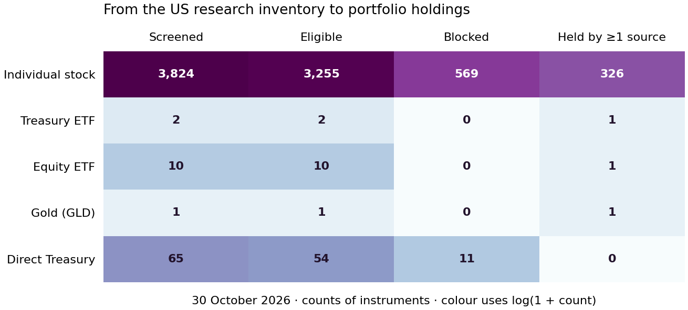

# RiskMatch V2 release verification

The release runs from a standalone GitHub checkout with Python 3.12. It supports a fictional CHF mandate, five dated research portfolios, user-selected blends, closing valuations and a separately confirmed revision. A public installation uses reproducible synthetic fill prices. With the original private first-close tape the same code buys different whole-unit positions. Both modes simulate subsequent closes. [Research notebook](../../RiskMatch_V2.ipynb) · [Application walkthrough and screenshots](../13-application/README.md)

The two isolated installations each passed 105 unit tests without skips. The browser exercised the full card path, correction, 60/40 choice, deposit, oil revision and restored portfolio on desktop and mobile emulation. The release inventories 268 tracked files. [Run evidence](verification.json)

## 14.1 · Reproduce the two routes

The audited environment is CPython 3.12.6 on macOS ARM64 with Google Chrome. The following commands use that platform's complete pinned dependency set, including the browser test client. The checkout must remain the working directory because the application and studies read its report files.

```sh
git clone https://github.com/NvarMaley/RiskMatch-V2.git
cd RiskMatch-V2
python3.12 -m venv .venv
. .venv/bin/activate
python -m pip install -r reports/14-delivery/requirements-macos-arm64-py312.txt
python -m pip install --no-deps --no-build-isolation -e .
python -m pip check
python -m unittest discover -v -s tests
python reports/14-delivery/inventory.py
python reports/14-delivery/replay.py public
python reports/14-delivery/notebook.py
python -m streamlit run app/questionnaire.py --server.address 127.0.0.1
```

While Streamlit is running, a second terminal with the same environment can run `python tests/parcours_navigateur.py` and `python tests/match_browser.py --url http://127.0.0.1:8501`. The first test completes the card route, corrects an answer, checks the export, exercises keyboard and touch input and cancels a partial swipe. The second confirms the 60/40 match, books a deposit, checks price freshness, revises oil exposure, exports, reopens and deletes its fictional dossier. The phone checks emulate a touch device in Chrome. On other platforms install the extras in [pyproject.toml](../../pyproject.toml) with native wheels. Only the platform above has a release lock and verification record.

To reproduce the private comparison, provide the matching `data/local/13/market-close.json` and the original `data/local/univers/e9d9400b2b65a9fd/` snapshot. The private full-universe check reads its membership, weights, `risk_0.npz` and `models.npz`. Earlier notebook studies can also use their own local archives. Run `python reports/14-delivery/replay.py private`, the notebook, and the same two browser commands from that checkout. Private mode fails explicitly if its first-close tape is missing. The public mode needs no archive, account login or external data API. [Source and delivery register](DATA.md)

**Two client paths.** Both clients confirm a 12% annual risk ceiling, select the same strategy shares and request an oil review after a simulated deposit. The CHF 50,000 goal for October 2029 and CHF 75,000 goal for October 2034 produce different funding requirements. The percentages below are the constant net growth rates required by the dated goals and cash flows. They are separate from the model's return estimates.

| Case | Initial sleeve | Protected reserve | Required annual growth | Public holdings / fee | Private holdings / fee |
|---|---:|---:|---:|---:|---:|
| A · October 2029 | CHF 35,000 | CHF 15,000 | 12.61% | 103 / CHF 21.49 | 195 / CHF 26.36 |
| B · October 2034 | CHF 50,000 | CHF 0 | 8.62% | 124 / CHF 33.94 | 216 / CHF 38.95 |

Both replays preserve the first portfolio and record exactly one subsequent revision. Each independently rejects a tested 38–42% request for that blend. For A the separate section 13 private benchmark shows an avoided adverse oil shock of CHF 15.42 for CHF 16.34 of fees. [Public results](public-replay.json) · [Private aggregate results](private-replay.json) · [Scenario assumptions](../13-application/README.md)

**Universe control as of 30 October 2026.** The private replay compared the exact eligible identifier set with the input names of the covariance model, rebuilt the optimization problem and reran the section 6 solver. Both identifier digests match. Of 3,902 screened instruments, 3,322 entered the solver and 580 failed the eligibility checks. The net-return optimum has 147 positions above the documented weight threshold. The union across the five source portfolios has 329 distinct instruments. The fixed historical 60/40 SPY–IEF reference has two positions, 9.41% estimated net return and 12.68% estimated volatility. The estimated net-return optimum reaches 43.71% at 12.00% model volatility. These are dated model outputs. The reference exceeds the 12% ceiling before it is resized for a client match.

| Asset class | Screened | Eligible | Blocked | Held by ≥1 source |
|---|---:|---:|---:|---:|
| Individual US stock | 3,824 | 3,255 | 569 | 326 |
| Equity ETF | 10 | 10 | 0 | 1 |
| Treasury ETF | 2 | 2 | 0 | 1 |
| Gold ETF | 1 | 1 | 0 | 1 |
| Direct US Treasury | 65 | 54 | 11 | 0 |



## 14.2 · Verify a number on screen

| Display | Definition and primary project evidence |
|---|---|
| Investable capital and risk ceiling | Confirm the active answers, deduct the protected reserve and use the explicitly accepted risk basis. [Fictional A](../07-funding/client-A.json) · [Fictional B](../07-funding/client-B.json) · [Risk review](../03-portrait/README.md) |
| Portfolio fee, risk, number of positions | Reconstruct the source weights, calculate whole units at the selected fill prices, deduct trading costs and re-evaluate portfolio volatility including cash. [Model](../13-application/market.json) · [Both tapes](../13-application/market-replay.json) |
| Account value, performance, cash flow | SQLite stores the dated units, FX, cash movements and confirmed versions. The three-close hand reconciliation ends at CHF 1,139.40 and a cumulative flow-neutral return of 5.1385%. [Reconciliation](../13-application/ledger-replay.json) |
| Scenarios, score and forecasts | Cash shock estimates are conditional sensitivities. Four available model components are rescaled for comparison. All section 12 signals retain zero allocation weight. [Score scope](../13-application/README.md) · [Signal decisions](../12-forecasts/registry.json) |

The [tracked-file inventory](public-files.json) assigns every release file a distribution category and fingerprints the numerical inputs. The [source register](DATA.md) identifies the local materials needed for upstream reconstruction, the rights evidence and the public substitutes.

## 14.3 · Intraday feasibility

On 23 November 2026 at 19:14 UTC, during US regular trading hours, the documented IBM demonstration endpoint returned 100 five-minute bars. Its newest timestamp was **20 November at 19:55 New York time**, 66.32 hours before receipt. The request took 0.54 seconds. This measures HTTP response time. The age includes the weekend and establishes the freshness of this sample at this observation. A separate January 2009 sample contained all **78/78** regular five-minute slots on 30 January. Each replayed bar passed OHLC and nonnegative volume checks against the XNYS calendar. Only timings and aggregate checks are distributed. [Observed timing and session replay](intraday.json) · [Reproduction code](probe_intraday.py)

Alpha Vantage identifies current and delayed US equity intraday access as premium; display entitlements depend on use. The documented free service allowance is 25 calls per day, below even a single full refresh of the 329-symbol union at one call per symbol. The historical IBM sample supplies a USD price for one security. The team verified neither an intraday USD/CHF feed nor display rights for a live portfolio. Alpaca offers venue-specific IEX data and distinct SIP feeds with separate entitlements. No project account entitlement was established. ECB reference rates are daily. [Alpha Vantage API](https://www.alphavantage.co/documentation/) · [Usage limits](https://www.alphavantage.co/support/) · [Market data policy](https://www.alphavantage.co/realtime_data_policy/) · [Alpaca feeds](https://docs.alpaca.markets/docs/about-market-data-api) · [ECB reference rates](https://www.ecb.europa.eu/stats/policy_and_exchange_rates/euro_reference_exchange_rates/html/index.en.html)

**Decision.** Intraday account pricing remains open. The Portfolio screen exposes its dated closing mode, the oldest held security/FX simulation marks and the measured age of the separate IBM sample. Stale price/FX or a superseded session blocks any dependent simulation order. The browser evidence records when the historical source check was actually visible. That later display time is a QA timestamp. One-way live vendor-to-screen latency remains unknown. [Browser and environment evidence](verification.json)

## 14.4 · Acceptance and remaining limits

| Requested behaviour | Independent release check | Outcome |
|---|---|---|
| Incomplete or contradictory portrait | Card and risk tests cover an uncertain expense, missing inputs and a zero sleeve. Browser correction changes the reserve and requires new consent. | Clarification or blocked mandate. |
| Out-of-range target | Analytic frontier tests establish feasible bounds for controlled examples. The release compares a 38–42% request to the actual rounded A and B proposals on both tapes. | The tested blends cannot be confirmed. A rejection of one blend establishes no global impossibility. |
| Ineligible security with historical data | Dated identity, CRSP events and liquidity tests keep historical records separate from current eligibility. Exact solver IDs are checked on the archive. | No rejected identifier enters the solver; calendar, FX gaps and incomplete histories have regression controls. |
| Empty universe | Construct the production feasibility problem with zero instruments. | Explicit rejection before optimization. |
| Simulated oil revision and simultaneous confirmation | Reprice the held units, display displaced risks and cost, compare retaining or switching, then book the chosen change. | Two client cases and a separate double-confirmation test preserve version history and book one revision. |
| Public vs private delivery | Start with a GitHub clone and isolated Python, rerun the notebook and UI in both modes, compare named numerical results and scan tracked files. | Expected whole-unit differences are reported. The public tape is synthetic. |

The unresolved research items are **6.3, 6.4 and 6.5** (documented historical exits, final proceeds and fully comparable long-run net performance), **9.2** (complete point-in-time US stock membership through 2026) and **14.3** (verified intraday account feed). The contemporary account-access check authorizes zero real orders. The behavioural scores remain theoretical. The demo's ten-point blend search uses five frozen source portfolios; a fresh solve over thousands of names is a separate research calculation. [Requirements matrix](../01-5-exigences/README.md) · [Historical replay limits](../univers-complet/replay-evidence.json) · [Checklist](../../CHECKLIST.md) · [Journal](../../JOURNAL.md)
