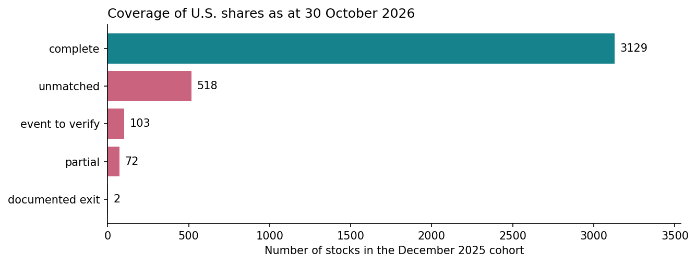

# US equities · extension until 30 October 2026

The initial population is 3,824 shares active at 31 December 2025 in local extraction. We looked for each one of them. Over the next ten months, **3,129 actions** have a complete set of markets within the meaning of the controls below. Among them, **3,113** also have at least 252 daily returns in CHF over the last 504 sessions, on the dates of the SPY, IEF and GLD factors. This last count gives the usable perimeter for a risk study on that date. [Verifiable results](resultats.json)

| Track condition 2026 | Actions |
|---|---:|
| Complete | 3,129 |
| Without connection | 518 |
| Event to be checked | 103 |
| Part | 72 |
| Documented output | 2 |
| Total reviewed | 3,824 |



## How the connection is established

1. **Find the title.** For each permanent CRSP identifier (PERMNO), the company, December symbol, class and CUSIP are retained. The Nasdaq directory, the SEC names and symbols, and the SPTM positions allow you to offer correspondence. The SPTM positions of 20 November also confirm the complete CUSIP of **1,410** series connected. These post-October publications are used to verify retrospective identities. [Definitions Nasdaq](https://www.nasdaqtrader.com/trader.aspx?id=symboldirdefs) · [SEC Yearbook](https://www.sec.gov/files/company_tickers_exchange.json) · [Positions State Street](https://www.ssga.com/library-content/products/fund-data/etfs/us/holdings-daily-us-en-sptm.xlsx)
2. **Check before contacting.** The public series must be an action in USD, on the American calendar, with a consistent class or name. The prices of 31 December after taking into account the securities divisions must be less than 1% of the CRSP prices. On November–December 2025, there are at least 20 common daily returns and eight variations of more than 0.1% in absolute terms. The median absolute deviation should remain at not more than 0.05 percentage point and the 95th percentile at 0.30 percentage point. A class conflict, an ambiguous symbol or a too short history suspends the connection. [Identity and continuity checks](../../src/riskmatch_v2/equity_extension/build.py)
3. **Extend returns.** CPRS returns are retained until December 31, 2025 inclusive. From January onwards, returns have been calculated since Yahoo Finance adjusted closures. Published dividends and divisions are kept in a register. Dividends are already present in the adjusted series. The CHF return is calculated by the product of the USD return factor and the change in the CHF price per USD, then one is withdrawn. Monthly returns use the closings and the exchange of both ends of the month. [Yahoo Finance History, Apple Example](https://finance.yahoo.com/quote/AAPL/history/) · [Change FRED DEXSZUS](https://fred.stlouisfed.org/series/DEXSZUS)
4. **Qualify each series.** A complete series requires prices, adjusted closure and positive volume for each of the 209 sessions, and passing event controls. Extreme jumps, unexplained adjustments and certain differences with dividends are reported. A missing day remains empty. To calculate a daily CHF return, an exchange rate is required for the two consecutive sessions. The change allows it on 207 of 209 sessions. A partial title, a documented output or an event to be verified is always included in the inventory.

## What the library contains

The archive extension **690,486 adjusted closing observations** identified and **33,037 monthly returns CHF** available, all connected statuses combined. The two tables combined contain the CRSP period and the extension with a source column and a quality column. The *Historical extension in 2026* panel on the Catalogue page now displays the search result by name, symbol or PERMNO. The notebook reproduces the graph and cumulative returns of examples, including Apple and the two Berkshire Hathaway classes. [Notebook](../../RiskMatch_V2.ipynb) · [Catalogue page](../../app/pages/2_Catalogue.py)

The event register keeps official sources when the old symbol disappears. CommScope changed its name and symbol on January 14, 2026. Dayforce and Confluent were purchased in cash for USD 70 and USD 31 per share, respectively. Buy-back prices are documented separately. They do not provide the daily intermediate prices or the date of payment on an account. [Deposit of Vist with SEC](https://www.sec.gov/Archives/edgar/data/1517228/000119312526014078/d749492d8k.htm) · [Dayforce announcement](https://www.dayforce.com/who-we-are/newsroom/thoma-bravo-completes-acquisition-of-dayforce) · [IBM Announcement](https://newsroom.ibm.com/2026-03-17-ibm-completes-acquisition-of-confluent,-making-real-time-data-the-engine-of-enterprise-ai-and-agents)

The prices are revised historical records consulted after the period. The starting inventory cannot contain the 2026 stock market introductions. Selecting today only the complete titles would introduce a survival bias into a replay that would start in January. A January study or a portfolio released in the prices of the year also requires monitoring of changes, potential fees and output products. Current account negotiability and the four historical ETF strategies retain their own protocol.

## Retrieving and reproducing data

From the root of V2, with local archives of sections 4 and 5 and Python options `catalogue` and `faisabilite` installed, the following commands restart collection and reconciliation.

```sh
python -m riskmatch_v2.equity_extension.fetch
python -m riskmatch_v2.equity_extension.build
```

Gross public replies and their receipts are in `data/local/actions-2026/2026-10-30/raw/`. The results of this release are in `data/local/actions-2026/2026-10-30/b97c1a71091eaa30/`.

| Local file | Use |
|---|---|
| `inventory.csv` and `inventory.parquet` | Find a name, identifier or symbol. Sort by status, pattern, coverage and number of exploitable returns. |
| `daily_combined_chf.parquet` | Daily CHF returns of the cohort since the historical cache of 2022, then public extension. |
| `monthly_combined.parquet` | Monthly USD and CHF returns from the historical library, then public observations of connected actions. |
| `daily_extension.parquet`, `monthly_extension.parquet`, `events.parquet` | prices, volumes, adjusted prices, returns and complement events. |
| `source_hashes.json` and `manifest.json` | Imprints of entries and products. |

To complete the trajectories still open, the file to be requested as a priority is the daily extract CRSP 2026 of the PERMNO concerned with date IDs, prices, volume, total return, distributions and settlement of outputs. The 695 cases to be completed or checked are combined in `a_completer.csv`, with the pattern and identifiers.

**Transversal control of sections 1 to 6.** As of October 30, 2026, the multi-asset study submitted 3,322 securities, including 3,255 individual stocks, 54 direct Treasuries and 13 ETFs. Previous comparisons of 13 ETFs are used as a control. [Multi-asset report](../univers-complet/README.md) · [Evidence by box](../univers-complet/AUDIT.md)
