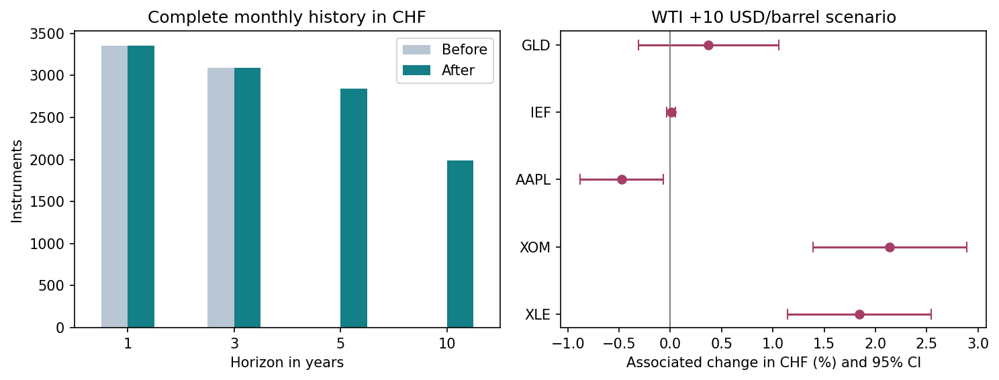

# Instrument econometrics as at 30 October 2026

Of the 3,902 instruments on the perimeter, 3,338 have a recent estimate of US market sensitivities, the dollar in CHF, oil and the US 10-year rate. Page **Catalogue** allows us to search for a title and open "Sensitivity to oil and rates, crises and volatility". The notebook and the [numerical results](results.json) present the published aggregates.

## Dates and changes

The main currency series of the project is supplemented at 33 sessions by the ECB's two references published on the same day. On 31 December 2021, 1 EUR was worth 1.1326 USD and 1.0331 CHF, or 0.912149 CHF per USD. This European fixation and that of the American source are observed at different times. Conversion is intended for historical research. The original version of the portfolio calculation keeps its own dated data. [ECB Publication of 31 December 2021](https://www.ecb.europa.eu/stats/exchange/eurofxref/shared/pdf/2021/12/20211231.pdf) · [Statistical portal ECB](https://data.ecb.europa.eu/data/datasets/EXR)

| Horizon | Securities with all monthly returns in CHF before | After |
|---|---:|---:|
| 1 year | 3,357 | 3,357 |
| 3 years | 3,088 | 3,088 |
| 5 years | 0 | 2,844 |
| 10 years | 0 | 1,989 |

## Sensitivity by security and portfolio

The variable explained is the daily return in CHF. The four explanatory variables are SPY's return in USD, the dollar's return in CHF, the WTI's change in dollars per barrel and the 10-year Treasury rate in percentage points. Levels are aligned with the schedule of sessions before calculating variances. Missing dates are excluded. The WTI can go through zero. The observations are historical and may include revisions. [EIA WTI](https://fred.stlouisfed.org/series/DCOILWTICO) · [Ten-year Treasury rate](https://fred.stlouisfed.org/series/DGS10)

Each estimate includes a constant. 95% individual intervals use Newey–West covariance at five delays, maintaining session spacing. They measure uncertainty on a coefficient. The four specifications cover the last 252 sessions, the previous 252, a window of 504, and a window of 252 where factors are delayed by one session. It takes 200 or 400 joint observations, respectively. On 3,213 comparable securities between the two years, the sign of sensitivity to oil is identical for 2,015. The intervals are not corrected for the multiplicity of comparisons.

| For a higher WTI of USD 10 per barrel, other constant factors | Association with daily return in CHF | Interval on association |
|---|---:|---:|
| Exxon Mobil (XOM) | +2.14% | +1.39% to +2.89% |
| Apple (AAPL) | −0.48% | -0.88 per cent to -0.07 per cent |
| Energy ETF (XLE) | +1.84% | +1.14% to +2.55% |
| Gold (GLD) | +0.37% | -0.31% to +1.06% |

The recent window provides 3,269 stock estimates, 56 direct Treasury securities and 13 fund estimates. The admission of securities to the allocation engine retains its threshold of 252 observations. For published portfolios, the coefficients per weight are added together, with zero exposure of CHF cash. All their positions have an oil coefficient. The scenario gives +0.10% for Performance, +0.11% for Robust, +0.12% for Diversification and +0.04% for Coverage. The weights are those of October 2026. This linear association can be extrapolated beyond current variations and does not predict the reaction of the next day of shock.

## Crisis, volatility and price acceleration

The dates of the episode and parameters are recorded in the [Protocol](../../config/econometrie.json). For each window the returns are composed from the starting close and converted into CHF. The measure requires each local daily return and changes it at both ends. The maximum decrease uses the available intermediate valuations. The number of titles observed is 2,722 for the February–March 2020 Covid shock, 3,383 for the first month of the invasion of Ukraine and 3,501 for March 2023. These returns also reflect other news of the period. The final selection of instruments is retrospective.

Since January 2023, two forecasts of variance are compared before each block of 21 or 63 sessions, without overlap within a horizon. The first model gives equal weight to the return squares in the 63 previous sessions. The second gives more weight to recent observations (decrease of 0.94). Both require 50 returns and one last observation available. The target is the average of future return squares on a complete block. The displayed volatility is annualized. The QLIKE average loss difference compares the accuracy of both models on the same windows per instrument. At 21 sessions, the exponential weighting is better for 873 of the 3,860 titles with at least eight windows. At 63 sessions, it is better for 812 out of 3,639. Retrospective selection and the absence of an uncertainty test of gain limit generalization. These models retain a zero weight in the recommendations.

The descriptive alert compares the sum of log returns in USD over the last 63 sessions to the average and dispersion of the previous 252 sessions (at least 200 observations). A score greater than or equal to two is observed for 32 of the 3,265 measurable titles. It describes an acceleration relative to the history of the title, with a convention of variance proportional to the duration. Its ability to anticipate a correction remains to be tested. Bubble diagnoses and probabilities remain open.

## Reproduce analysis

Run `python -m riskmatch_v2.econometrics` since V2 with the catalog dependencies and archives of the multi-asset universe. Both ECB series are downloaded if necessary and checked by fingerprint. The file `data/local/econometrics/<snapshot>/` contains the sheets, the monthly matrix in CHF and the results per identifier in `sensitivities.parquet`, `crises.parquet`, `forecasts.parquet` and `momentum.parquet`. Identifier of the version is given in the [Executive summary](results.json). The public notebook can be executed with this summary alone.
