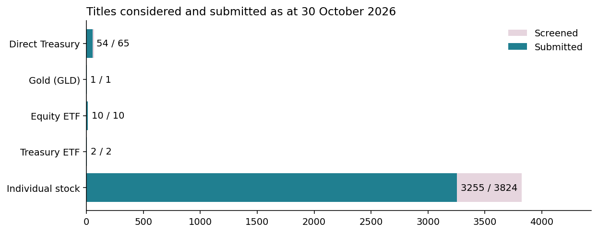
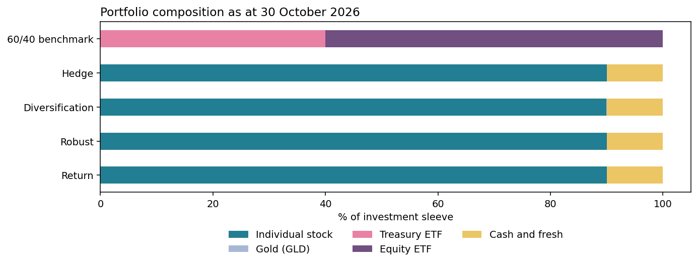
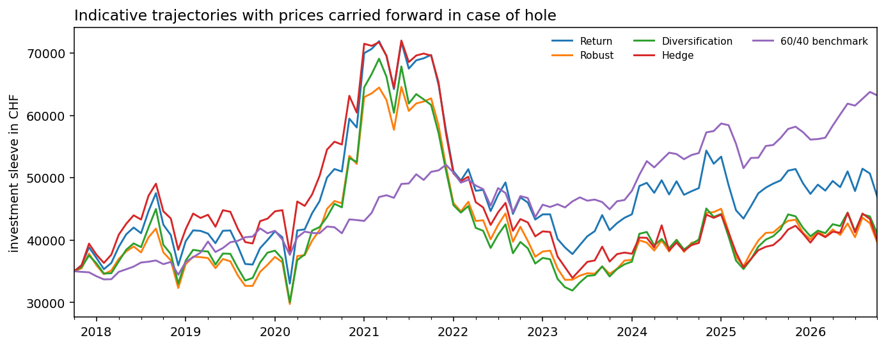

# Verification of selected assets and multi-asset comparison

The updated fact sheets include the supplementary ECB exchange rates, individual sensitivities to WTI and rates, three crises and comparison of volatility forecasts. [Econometric results](../econometrie/README.md)


On 30 October 2026, **3,322 of the 3,902 instruments reviewed passed the research model’s input checks**. Ten annual decisions were reconstructed for 2017–2026. Instrument-level data and simulated orders are in the local archive. The published report contains the aggregate results. [Audit of 43 checklist items](AUDIT.md) · [Main notebook](../../RiskMatch_V2.ipynb) · [Results](resultats.json)

| Class | Screened | Subject to calculation |
|---|---:|---:|
| Individual stock | 3,824 | 3,255 |
| Treasury ETF | 2 | 2 |
| Equity ETF | 10 | 10 |
| Gold (GLD) | 1 | 1 |
| Direct Treasury | 65 | 54 |



## Data and scope

**US stocks.** Each historical decision starts from the US common stocks identified in CRSP at the time, using PERMNO, trading status and the price on the decision date. The October 2026 study starts with the 3,824 stocks in the end-2025 cohort. Nasdaq provided an October 30 quote for at least one candidate ticker in 396 of 695 incomplete records. Matching by ticker alone cannot establish identity. For 140 previously identified records, an independent source confirmed recent closing prices and liquidity or an extreme price change. The model then requires 252 observations. Data retrieved after the decision dates support a historical reconstruction. [CRSP connection](../actions-2026/README.md) · [History Nasdaq](https://www.nasdaq.com/market-activity/stocks/aapl/historical)

The Nasdaq IPO calendar lists 289 priced deals in the first ten months of 2026. The archive records their names, dates and exchanges. New listings could have at most 209 trading sessions by October 30. Transfers, multiple share classes, relistings and any earlier history require verified identifiers before inclusion. Coverage of every tradable US stock has yet to be established. [IPO Nasdaq Calendar](https://www.nasdaq.com/market-activity/ipos)

**Direct US Treasuries.** Each of the 65 issues identified in IEF/TLT holdings was researched individually. Auction records provide its coupon, issue date and maturity. The archive contains 75,822 daily closing quotes for 64 issues between October 2014 and October 2026. CUSIP 91282CRV5 was issued on 2 November 2026. The dirty price per USD 100 of face value equals the closing clean price plus interest accrued over the actual semiannual coupon period. When a coupon period changes, the replay credits the coupon in cash at the next observed Treasury price. Historical instrument profiles reinvest coupons. The list of 65 issues comes from a November 2026 holdings disclosure, so comparisons of earlier periods are conditional on a retrospectively selected list. [FedInvest, prices by date](https://www.treasurydirect.gov/GA-FI/FedInvest/selectSecurityPriceDate) · [Treasury awards](https://fiscaldata.treasury.gov/datasets/treasury-securities-auctions-data/) · [Rules for calculating interest](https://www.treasurydirect.gov/files/laws-and-regulations/auction-regulations-uoc/31-cfr-part-356.pdf)

**ETFs and factors.** SPY and nine sector funds provide equity exposure. IEF and TLT provide Treasury exposure, and GLD provides gold exposure. WTI spot and the ten-year US Treasury yield are explanatory factors. Positions are converted into CHF, and CHF cash earns zero interest in this model. The account-access check does not authorize orders. The addition of November prices alone cannot establish tradability.

## Sheets and allocations

The records of the 3,902 instruments show the number of staff over 1, 3, 5 and 10 years. An incomplete period retains an average and volatility if the workforce allows it. A full cumulative return requires a workable return chain. The Catalogue also allows you to choose two instruments and observe their Pearson and Spearman correlations and their annualized covariance in CHF over the same months.

The engine retains the dates common to all three SPY, IEF and GLD factors and requires at least 252 returns in CHF in the last 504 sessions. Risks combine three factor exposures and one risk specific to each security. The models use 504 or 756 sessions. To limit the influence of a single extreme average among several thousand candidates, annual averages per instrument are reduced to percentages 1 and 99 calculated at the date, then reduced by 50% or 75% towards the middle of the universe. returns from the game keep the raw observations. Residues of different titles are assumed to be independent in this model. The September–November 2008 shock uses an observed CHF return for assets with an available trajectory and factor projection for others. This projection may underestimate significant specific losses. The 12 per cent volatility ceiling is for weight on the investment sleeve and an estimate to date.

| Option for October | Positions | Estimated net return | Estimated volatility | Loss of scenario 2008 | Verifiable annualized net return on all replay |
|---|---:|---:|---:|---:|---:|
| Return | 147 | 43.71% | 12.00% | 23.18% | unavailable |
| Robust | 147 | 43.70% | 12.00% | 23.24% | unavailable |
| Diversification | 326 | 41.21% | 12.00% | 23.71% | unavailable |
| Hedge | 135 | 41.21% | 12.00% | 7.51% | unavailable |
| 60/40 benchmark | 2 | 9.41% | 12.68% | 15.80% | 6.79% |



| Allowed universe with the same assumptions | Instruments submitted | Significant positions | Estimated net return maximum | Estimated volatility |
|---|---:|---:|---:|---:|
| ETFs only | 13 | 5 | 12.54% | 12.00% |
| Individual stocks only | 3255 | 147 | 43.71% | 12.00% |
| Direct Treasuries only | 54 | 2 | 6.20% | 8.93% |
| Full universe | 3322 | 147 | 43.71% | 12.00% |

return is an annualized and regularized historical average, chosen after optimisation among thousands of titles. A high value is particularly sensitive to this selection. The milestones, three recalibrations, eight block prints and subsequent evaluations of 63 sessions are reflected in the results. A significant position exceeds a ten millionth of the investment sleeve. The 60/40 reference exceeds the 90% investment limit. The historical performance of the benchmark in Section 6 remains available with his dividend agreement. [Study on the 13 ETFs](../06-options/README.md)

## Replay and limits of scores

The 35 simulations include nine annual decisions per trajectory, the same CHF 35,000 invested, the external reserve of CHF 15,000 and the requested withdrawal of CHF 1,000 in March 2022. Annual targets are calculated as a new mandate in cash, and then the game executes deviations from positions actually held. The tested fee values are 0, 10, 25 and 50 basis points. Variants also test the extra session, missed basket and entire quantities. The batch hypothesis uses an action/part or 100 USD nominal of the Treasury securities. The reference and strategies all use the same agreement for reinvestment of shares distributions and ETFs. Bonds pay their coupon in cash. Sales remain to be settled until the next session in the simulation.

Admission shall be made at each decision date. After a purchase, the portfolio continues to use daily prices available under the same PERMNO, even when the title leaves the monthly selection. Transactions require observed exchange rates. The register shall keep the last price for the indicative valuation of a pending security. A total missing value on a sided day or a non-prices position for more than three sessions suspends certification. A CRSP cash out payment is reconciled with the full monthly return to avoid double counting. CRSP terminal events fully payable in USD at the latest to the detachment give an amount per share, even if the title disappears before the end of the month. For EXA, the amount of USD 24.25 is consistent with Nasdaq's contract notice. Mixed or securities offers and deferred payments require details of the counterparty and settlement. An unknown output remains visible. [Nasdaq opinion for EXA](https://www.nasdaqtrader.com/TraderNews.aspx?id=ECA2017-73) The final value and costs can still be inspected after a break, with their indicative status. A reconciled daily balance does not validate a missing prices.

### Follow-up on the first coverage break

The original frozen run stopped at 37 comparable sessions. Replaying the initial holdings through January reproduced all five archived daily ledgers before the repair. Peoples Financial (PFBX, PERMNO 88257) moved from Nasdaq to OTCQX on 18 December 2017. The follow-up matches the CRSP identity and the preceding five traded closes, keeps the original 18 December mark and joins subsequent positive-volume USD closes. An unchanged vendor close with zero volume does not provide a new observed mark. The bridge admits no corporate action in its return interval and generates no OTC orders. [Issuer’s SEC filing](https://www.sec.gov/Archives/edgar/data/770460/000119312517371358/d512172dex991.htm) · [Quote source, fingerprint and scenario results](replay-evidence.json)

Across five options and seven execution assumptions, the common window now reaches **51 sessions through 12 January 2018**. These returns use the central fee convention and the existing rule that permits carrying a missing quote for up to three sessions.

| Option | Audited common period end | Sessions | Cumulative return in CHF |
|---|---|---:|---:|
| Return | 2018-01-12 | 51 | 14.48% |
| Robust | 2018-01-12 | 51 | 11.52% |
| Diversification | 2018-01-12 | 51 | 11.08% |
| Hedge | 2018-01-12 | 51 | 16.32% |
| 60/40 benchmark | 2018-01-12 | 51 | 1.40% |

**What remains.** On 16 January, the fourth consecutive unpriced session for Barington/Hilco Acquisition (BHAC, PERMNO 15266) triggers the replay rule. The original CRSP daily extract has eight trading sessions from 10 to 22 January with no close, total return or ask; the only bid is USD 0.01. A closing price returns on 23 January. An independent contemporaneous trade or valid two-sided quote, together with evidence about distributions, is needed to value the intervening dates. If none existed, full daily verification under this rule cannot be recovered for that interval. A later close cannot establish an earlier daily mark. The Nasdaq historical quote endpoint returned “Symbol not exists” for this old ticker and date range. For a targeted data extract, request US consolidated trades and closing bid/ask quotes for BHAC common stock (PERMNO 15266) on 10–22 January 2018, including timestamps, trade/quote conditions, and any halt or corporate-action record. The reference trade dates on either side are 9 and 23 January.

**Cash and costs.** Reaggregating the original 39,408 recorded fills by execution date reconciles fees, traded amounts, cash (including previous-day settlement, coupons and the withdrawal) and NAV across 11,310 option-days. The largest absolute difference is below CHF 0.0001. This confirms ledger arithmetic; independent evidence is still required for the value and settlement of economic events. The original archive flags 204 distinct securities in the central paths and 206 across all scenarios over nine years. The audit writes a local follow-up list to `data/local/6/repair/requested-identifiers.json`. The list describes the original archive, not 206 confirmed data errors. The original nine-year values and scores retain their indicative or unavailable status.

To reproduce the follow-up with the private sources installed, run `python -m riskmatch_v2.universe.replay_evidence`. It fetches the supplementary quote file if absent, verifies its historical fingerprint on subsequent runs and reports all 35 scenarios over the same prefix. The nine-year chart below remains the original indicative replay.



The annual strategy score remains suspended as soon as an indispensable measure is missing. The page shows separately an optional diagnosis of the fixed weights of October over the previous 12 months, with monthly rebalancing and trade fees. This diagnosis knows the final composition from the beginning. It does not validate a forecast. New portfolio evaluations of 63 sessions provide 14 valueable windows out of 45 trials, including reference. The absence of price or exit history remains the main obstacle to a certified nine-year comparison.

## Reproduction and files

From the root of V2, install options `catalogue,faisabilite,notebook,questionnaire`. The local archives of sections 4, 5 and the 2026 action connection are necessary to recalculate the private study. The repository is sufficient to display aggregates and notebook figures.

```sh
python -m riskmatch_v2.universe.study
python -m unittest discover -s tests
jupyter nbconvert --to notebook --execute --inplace RiskMatch_V2.ipynb
streamlit run app/questionnaire.py
```

Page **Options** opens the complete universe by default. In the local copy, you can modify the band, exclude securities, compare variants and combine multiple portfolios. The revised portfolio is recalculated on all submitted securities, and the published historical score remains attached to the mandate for which the trajectories were replayed.

The private directory `data/local/univers/e9d9400b2b65a9fd/` contains membership and reasons on each date (`membership.parquet`), all positions (`weights.parquet`), the register of orders and values (`orders.parquet`, `nav.parquet`), contributions to risk, sheets, correlations which can be calculated from `monthly_all_chf.parquet`, OPIs and Nasdaq controls. Notebook also generates `data/local/univers/exports/e9d9400b2b65a9fd/inventaire.csv`, `allocations.csv` and `valorisations_a_verifier.csv` for direct opening. The third file identifies titles whose central trajectory has at least one break, by strategy. The archived market parameters and the fingerprints of the entries and products allow us to find the exact calculation. [Code](../../src/riskmatch_v2/universe/study.py) · [Aggregated outputs](resultats.json)
