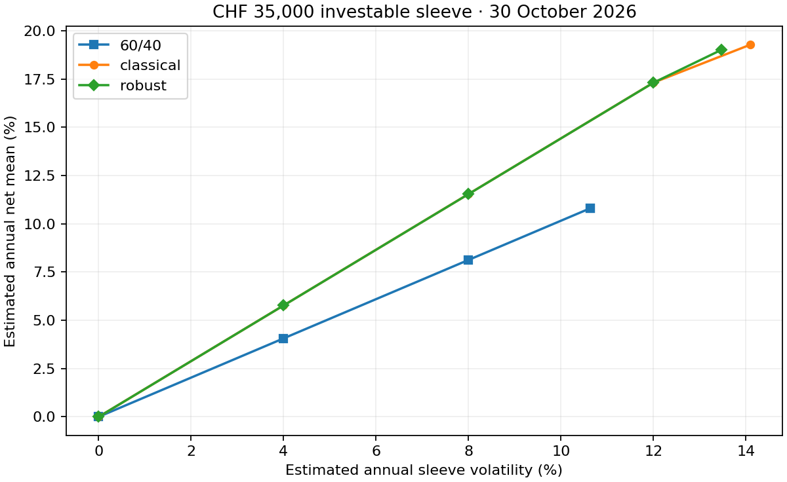

# 6.1 · Quels portefeuilles respectent le mandat en CHF ?

**Univers principal actuel.** Le rapport historique ci-dessous conserve le périmètre de son étude initiale. Les nouveaux portefeuilles, scénarios et résultats sur les treize ETF sont documentés dans la [comparaison à 13 ETF](../universe/README.md).

Sur 50 000 CHF, le mandat illustratif impose un retrait de 15 000 CHF dans un an. Le calcul de liquidité du projet place cette somme en réserve avant tout achat. Les stratégies disposent des mêmes **35 000 CHF**, frais compris. Au 30 octobre 2026, avec une limite de volatilité annuelle de 8 % sur cette poche, le portefeuille robuste garde environ 15 473 CHF de liquidités supplémentaires. Les estimations de rendement favorisent alors les actions et l'or. Un changement d'échantillon modifie fortement les poids. [Protocole](PROTOCOL.md) · [Allocations en CHF](results/latest.csv)

## Un exemple que l'on peut réconcilier

Les trois colonnes utilisent le même mandat, le même jour et la même limite de risque. Les montants sont arrondis au centime. Les chiffres de rendement du tableau sont des estimations annuelles arithmétiques sur la poche de 35 000 CHF, après le coût d'entrée. Le rendement du cash CHF est fixé à zéro.

| Au 30 octobre 2026 | Mix actions/obligations 60/40, ajusté au risque | Optimisation classique | Optimisation robuste |
|---|---:|---:|---:|
| Actions américaines (SPY) | 14 217,01 CHF | 10 606,82 CHF | 10 342,56 CHF |
| Obligations du Trésor américain (IEF) | 9 478,01 CHF | 0,00 CHF | 0,00 CHF |
| Or (GLD) | 0,00 CHF | 8 947,17 CHF | 9 165,39 CHF |
| Liquidités disponibles dans la poche | 11 281,29 CHF | 15 426,45 CHF | 15 472,54 CHF |
| Frais d'achat modélisés | 23,70 CHF | 19,55 CHF | 19,51 CHF |
| Réserve de retrait en plus de cette poche | 15 000 CHF | 15 000 CHF | 15 000 CHF |
| Rendement net estimé de la poche | 8,13 % | 11,54 % | 11,54 % |
| Volatilité estimée de la poche | 8,00 % | 8,00 % | 8,00 % |

La réserve et les liquidités de la poche ont deux usages différents. La première est affectée au retrait. Les secondes permettent de tenir la limite de risque et restent investissables. Les 8 % de volatilité sur 35 000 CHF correspondent à 5,6 % sur les 50 000 CHF initiaux avec la réserve à valeur constante. Les moyennes historiques annualisées ayant servi au dernier calcul étaient de 19,10 % pour SPY, 1,62 % pour IEF et 22,72 % pour GLD en CHF. Elles expliquent le poids quasi nul d'IEF dans les deux optimisations de cet exemple. [Estimations et dates d'information](results/training.json)



Les points représentent les plafonds de 0 %, 4 %, 8 %, 12 % et 16 %. Le graphique place chaque point au **risque effectivement utilisé**. Un plafond plus élevé peut laisser les poids identiques si une autre contrainte limite les positions. Les courbes classique et robuste se superposent presque jusqu'à 12 % lorsque toutes deux sont évaluées avec la même estimation de rendement net. L'objectif robuste inclut aussi une pénalité d'incertitude. À 8 %, son score pénalisé est de 7,81 %. [Frontières aux huit dates](results/frontiers.csv)

## Ce que contrôle le calcul

- **Éligibilité et financement.** Le filtre contrôle la disponibilité récente des prix convertis en CHF, la cotation à la date de décision, la devise autorisée et les exclusions. Un filtre éthique exigeant une transparence indisponible écarte le titre concerné. Le mandat de base autorise les trois ETF sans filtre sectoriel. La concentration est plafonnée à 60 % de la poche par titre et l'exposition totale aux ETF en USD à 90 %. Un mandat tout CHF conserve du cash. Avec seulement 10 000 CHF pour payer 15 000 CHF, le rapport affiche 5 000 CHF manquants. L'optimisation ne peut pas engager la réserve. La présence d'un prix constitue un indicateur de liquidité. La profondeur disponible, le prix effectivement obtenu et le règlement chez un courtier restent inconnus. [Éligibilité datée](results/eligibility.csv) · [Cas de mandat](results/mandate_cases.csv)
- **Références.** Les huit lignes par plafond couvrent le cash, l'équipondération, le mix 60/40, deux constructions de variance minimale, la parité de risque et les deux optimisations. Les allocations simples conservent leurs proportions puis se réduisent si une limite l'impose. La première variance minimale estime les proportions de la poche risquée avant réduction. Le contrôle complémentaire impose la concentration dès le calcul de ces proportions : il est identifié dans le protocole après la première simulation. Avec le cash inclus librement, le minimum absolu de variance est le tout-CHF. Les diagnostics donnent le bêta et l'écart de suivi par rapport au mix 60/40 ajusté au même plafond, ainsi que le ratio de diversification. Black–Litterman retrouve le benchmark illustratif à la précision numérique lorsque la confiance dans l'opinion est nulle. La validation empirique du sentiment du chapitre 5 reste applicable. [Contrôle Black–Litterman](results/conditional_prior.csv)
- **Frontière nette.** Les positions sont exprimées en fraction du capital de la poche avant transaction. Le modèle finance les achats et débite 10 points de base sur les montants échangés : 2 pour la commission, 3 pour le demi-spread et 5 pour la conversion, tous hypothétiques. Les parts d'ETF intègrent déjà leurs charges internes dans les prix utilisés. Le solveur CLARABEL renvoie les contraintes actives et la sensibilité de l'objectif au plafond de volatilité. Le contrôle analytique à deux actifs donne un multiplicateur de 0,60208 lorsque la limite est active et pratiquement zéro lorsqu'elle est inactive. Les différences finies de chaque côté le confirment à moins de 0,000001. La grille conserve les solutions dominées pour audit et les signale lorsque l'une des autres solutions calculées a un rendement au moins aussi élevé et un risque au plus aussi élevé, avec une amélioration stricte au-delà de la tolérance. [Contrôles numériques](results/duals.csv) · [Tests indépendants](../../tests/test_frontier.py)

## Comment les résultats changent

L'estimation utilise les 756 séances précédentes, avec une séance de recul, les rendements conjoints en CHF et un seuil de 719 observations complètes. La dernière fenêtre en compte 744. La covariance des rendements mesure le risque des actifs. Une seconde matrice, estimée sur 199 rééchantillonnages par blocs de 21 séances, mesure l'incertitude des moyennes annuelles. La méthode classique maximise la moyenne nette. La méthode robuste retranche un écart-type d'incertitude sur cette moyenne. Le rayon a été fixé à un avant le calcul. Les données historiques sont celles de l'instantané archivé du projet et leurs dates de réception d'origine sont inconnues.

Au plafond de 8 %, diminuer la moyenne annuelle de SPY de deux points réduit son poids robuste de 29,6 % à 27,3 %. Sur 99 rééchantillonnages conjoints avec réestimation, les 5ᵉ et 95ᵉ percentiles de ce poids vont d'environ 0 % à 50,2 %. Il s'agit d'une dispersion des estimations sur cet historique. Les 1 485 combinaisons échantillon, plafond et stratégie ont livré une solution admissible selon leurs propres paramètres. Recontrôlées avec la covariance de base au plafond de 8 %, les trois allocations recalculées dépassent toutes la limite dans 51 tirages sur 99. Dans les autres tirages, l'objectif pénalisé de base classe en tête la robuste 16 fois, la classique 14 fois, le mix 60/40 14 fois et les deux optimisations à égalité numérique 4 fois. Un portefeuille à la limite gagne donc à être contrôlé de nouveau si l'estimation du risque change. [Scénarios déterministes](results/scenario_sensitivity.csv) · [Dispersion et dénominateurs](results/dispersion.csv) · [Classements à contraintes identiques](results/bootstrap_ranks.csv)

## Ce que les sept périodes historiques ont donné

Chaque fin octobre de 2019 à 2025 démarre un **nouveau cas** avec 50 000 CHF. Les positions sont achetées à la première clôture commune disponible après la décision et valorisées environ un an plus tard. Les frais sont payés à l'entrée. Le retrait provient de la réserve. Les ETF restants sont valorisés au cours de clôture, sans vente finale imposée. Le rendement du foyer est calculé avant de déduire ce flux externe. À la limite de 8 %, le rendement annuel moyen sur **la totalité des 50 000 CHF** s'établit à 2,92 % pour le mix 60/40, 4,34 % pour l'optimisation classique, 4,14 % pour la robuste et 4,24 % pour l'équipondération. Dans chaque cas le retrait de 15 000 CHF est payé. L'équipondération présente le meilleur score moyenne–variance illustratif parmi ces quatre méthodes. Sept périodes historiques déjà étudiées ne permettent pas de sélectionner une stratégie personnelle. [Résultats par période](results/realized.csv) · [Comparaison des stratégies](results/historical_summary.csv)

## Reproduire la section 6.1

Depuis la racine, avec Python 3.12 et le fichier de marché préparé du dépôt :

```sh
python -m pip install -r requirements-frontier.txt
OPENBLAS_NUM_THREADS=1 python research/frontier/run.py
python tests/test_frontier.py
```

Le programme vérifie l'empreinte du marché et compare une nouvelle exécution au résultat archivé. Pour produire une sortie sur une autre plateforme, utiliser `--output DOSSIER_NEUF`. Les bibliothèques numériques et le rendu PNG peuvent varier selon l'environnement. Les colonnes w0, w1 et w2 désignent SPY, IEF et GLD. Les rendements, volatilités, frais et poids sont exprimés en décimales, sauf colonnes explicitement en CHF. [Empreintes des fichiers](results/manifest.json)
